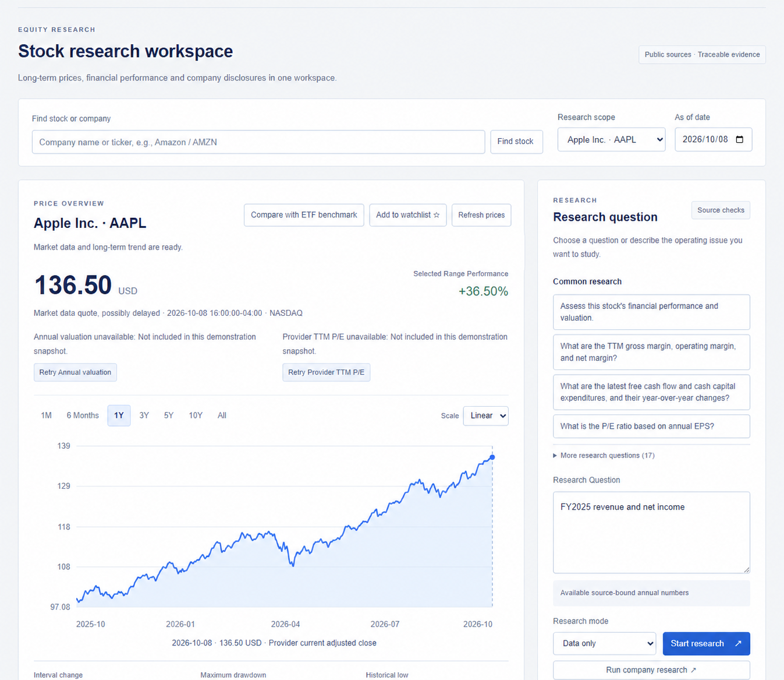
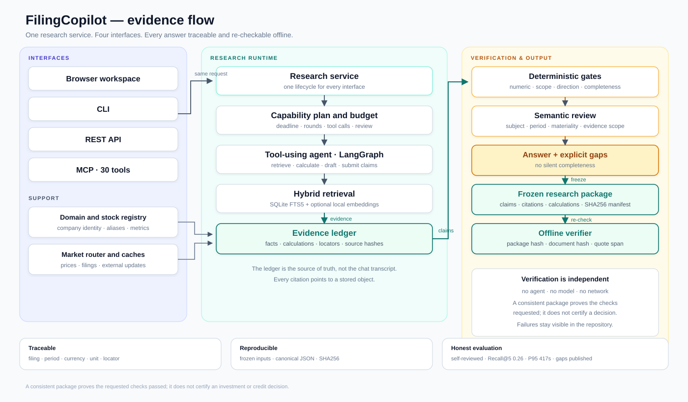

# FilingCopilot

<p align="center">
  <strong>English</strong> · <a href="./README.zh-CN.md">简体中文</a>
</p>

<p align="center">
  <a href="https://github.com/francisown/filingcopilot/actions/workflows/ci.yml"></a>
  <a href="./LICENSE"></a>
  <a href="https://www.python.org/downloads/"></a>
</p>

**Evidence-grounded research for company filings. Every number traceable to a source; every answer exportable and verifiable offline.**

FilingCopilot is a local-first workspace for SEC filings, financial calculations, and cited
research. Ask a question in English or Chinese, open the passage behind a number, or export
the facts, calculations, and citations as a frozen package that a reviewer can re-check
without the model.



*Interface example using bundled filing data and illustrative prices. The chart is not a live quote.*

Three things a chat-only RAG demo usually does not do:

- **Trace every number** to a filing, reporting period, currency, unit, and line locator.
- **Freeze the evidence** into a package with a SHA256 manifest, then verify it offline.
- **Answer deterministic questions without an LLM** — annual numbers, growth, margins, and trends run on the local corpus.

## Verified on the recorded evaluation

| Signal | Result |
|---|---|
| Bilingual evaluation | 140 questions; 100 research questions: **81 complete, 18 partial, 1 no answer**; 40 boundary questions answered with explicit limits |
| Numeric oracle | **116 exact SEC CompanyFacts or arithmetic matches, 0 mismatches**; 34 claims outside the checker's scope |
| Retrieval gold set | 200 questions; **Recall@5 0.430, MRR@5 0.245** after the deterministic coverage rerank (lexical baseline 0.255/0.142; recorded hybrid baseline 0.260/0.150) |
| Tests | **1,656 passed** at the recorded evaluation source; **1,718 passed** on the current branch |
| Surfaces | Browser, CLI, REST API, and **30 MCP tools** on the same research service |
| Codebase | ~23k lines of Python across 77 source modules |

**Read the caveats before the numbers:** the evaluation is self-reviewed, there is no independent human gold standard, and model-using questions had a median latency of 92.8 seconds and a P95 of 417.1 seconds. Retrieval is exact-passage on a development gold set, not human relevance; 0.430 still leaves room. These are engineering measurements, not a production claim. The full method and denominators are in [Evaluation](docs/evaluation.md).

## How it works



1. A question arrives through the browser, CLI, REST API, or MCP.
2. The research service builds a capability plan and a budget.
3. A LangGraph tool-using agent retrieves passages and calls financial tools.
4. The evidence ledger stores facts, calculations, sources, and line locators.
5. Deterministic numeric and narrative gates accept, repair, or reject claims; a semantic reviewer checks subject, direction, period, materiality, and scope.
6. The answer and its explicit gaps are frozen into a package. The standalone verifier re-checks the package without the agent, the model, or the network.

See [Architecture](docs/architecture.md) and the [Independent verifier](docs/independent-verifier.md) for the contracts.

## Fast path (60 seconds, no API key)

```powershell
.\setup.ps1
$env:FC_EMBEDDING_MODE = "off"
.\start.ps1 -Port 8159
```

Open <http://127.0.0.1:8159/>, choose **Apple / AAPL**, select **Data only**, ask
**“What were Apple's FY2025 revenue and net income?”**, open a citation, then export the
research package. To verify the bundled example without the app:

```powershell
.\.venv\Scripts\python.exe -m filingcopilot verify-package examples/annual-facts.json
```

The same evidence layer runs on a synthetic credit-risk corpus:

```powershell
python examples/credit-risk/demo.py demo
```

A click-by-click walkthrough is in [demo-script-3min.md](docs/outreach/demo-script-3min.md); the credit-risk vertical is documented in [examples/credit-risk/README.md](examples/credit-risk/README.md).

## Start with the evidence

- [Case study (English)](docs/case-study.md) · [案例研究（中文）](docs/case-study.zh-CN.md) — the problem, architecture, evaluation, failure taxonomy, and limitations.
- [Evaluation](docs/evaluation.md) — 140-question run, retrieval gold set, negative results, and exact denominators.
- [Retrieval coverage rerank](docs/retrieval-coverage-2026-10-23.md) — how exact-passage R@5 moved from 0.255 to 0.430, and what is still weak.
- [Research package protocol](docs/research-package-protocol.md) — what a frozen package contains and how it is replayed.
- [Project overview](docs/showcase.md) — try the offline example and follow one request through the code.
- [MCP tools](docs/mcp-tools.md) · [Contributing](CONTRIBUTING.md) · [Full quick start](#quick-start)

## Features

| Feature | What it does |
|---|---|
| Company and stock search | Search by name or ticker, choose the correct listing, and download supported SEC filings. |
| Long-term price charts | Switch between one year, five years, full history and other intervals. Hover to inspect dates and prices; view currency, timestamps and adjustment basis. |
| Financial data | Query annual, quarterly, year-to-date and trailing-twelve-month data. Calculate growth, margins and clearly defined cash-flow measures. |
| Financial trends | Explore three- or five-year revenue, earnings and cash-flow charts. Missing years remain missing; click a figure to inspect its source. |
| Company research | Read business and risk disclosures, financial statements, available segment data, and filing revisions. |
| Official updates | Read supported companies' recent official disclosures, dates and source excerpts. Configured models can produce cited summaries. |
| Company comparison | Compare financial figures and price returns over shared dates, with an optional ETF benchmark and current provider TTM valuation. |
| Valuation scenarios | Compare annual and provider TTM P/E, inspect supported historical annual P/E data, and explore editable earnings and cash-flow assumptions. |
| Research agent | Ask focused questions or run a six-part company review. Track progress, ask follow-up questions, cancel a task, or reconnect after refreshing the page. |
| Saved research | Maintain a watchlist, reopen results, export research packages and inspect changes between research versions. |
| Offline verification | Recompute saved calculations and check a research package. Provide the matching source files to check their contents against the saved evidence. |
| Integrations | Use the browser, CLI, REST API or 30 MCP tools. |

**Stock charts do not require downloading annual reports first.** Explicit annual numbers,
growth rates, margins and financial trends can run without an LLM. Explanations, generated
announcement summaries and company reviews require model configuration. Incomplete
evidence can lead to a partial answer; the interface shows what is still missing.

## Quick start

Requires Python 3.10 or later. Download the source and run these commands in the project
directory. You can start with the bundled filing data **without a model API key or GPU**.
Live prices and new filings require internet access.

### Windows PowerShell

```powershell
.\setup.ps1
if (-not (Test-Path -LiteralPath .env)) {
    Copy-Item .env.example .env
}
$env:FC_EMBEDDING_MODE = "off"
```

Start the workspace with keyword search:

```powershell
.\start.ps1 -Port 8159
```

The installer selects a supported Python version, reuses a compatible `.venv`
and installs core dependencies from PyPI. Interpreter selection, optional profiles
and installation troubleshooting are covered in the [installation guide](docs/installation.md).

Open [the local workspace](http://127.0.0.1:8159/). Keep the service terminal running;
press `Ctrl+C` in that terminal to stop it. Existing installations can use the start
command directly. The conditional copy preserves an existing `.env`. The embedding
setting above applies to this terminal session; local embeddings are optional.

### macOS / Linux

```bash
python3 -m venv .venv
.venv/bin/python -m pip install -e "."
if [ ! -f .env ]; then
    cp .env.example .env
fi
```

If a configured mirror cannot provide the build dependencies, retry with
`--index-url https://pypi.org/simple`.

Start with keyword search:

```bash
FC_EMBEDDING_MODE=off .venv/bin/python -m filingcopilot serve --port 8159
```

Open `http://127.0.0.1:8159/`.

### Try it before configuring a model

1. Choose **Apple / AAPL** and **Data only**.
2. Ask **“What were Apple's FY2025 revenue and net income?”**
3. Open a citation to inspect the reporting period and source.
4. Export the research package, or verify the bundled example:

```powershell
.\.venv\Scripts\python.exe -m filingcopilot verify-package examples/annual-facts.json
```

The bundled example can be checked without network access. On macOS/Linux, replace the
Python path with `.venv/bin/python`. Live stock charts load separately from this filing demo.

### Enable live filings and AI research

Configure `.env` to download new filings or use a research model.

| Variable | Purpose |
|---|---|
| `FC_SEC_USER_AGENT` | Your real contact name and email, required for online SEC requests. |
| `FC_API_BASE` | An OpenAI-compatible model endpoint supporting tool calls. |
| `FC_API_KEY` | The model provider's access key. |
| `FC_EXTRA_HEADERS` / `FC_SESSION_ID` | Optional provider-required request headers; keep real values private. |
| `FC_MODEL` | The research model. |
| `FC_REVIEW_MODEL` | The analysis-review model; use a different model where possible. |
| `FC_EMBEDDING_MODE` | `off` for keyword search; `local` for optional local embeddings. |
| `FC_TWELVE_DATA_API_KEY` | Optional independent daily-price fallback, subject to provider access. |

Set the model endpoint, key, and model names to enable **AI research**. This mode sends
the question and selected evidence to your configured provider and may incur model usage
charges. The app does not place trades.

For optional vector search, install `.[semantic]` in the same virtual environment and set
`FC_EMBEDDING_MODE=local`. If you used the Windows quick start, also change that terminal's
`$env:FC_EMBEDDING_MODE` to `"local"` or start a new terminal. First use downloads model files;
keyword search does not need them.

## Using the workspace

1. **Choose your language.** The interface starts in English, including on a Chinese-language browser.
   Choose 中文 in the header to use Chinese; your explicit choice is saved locally.
2. **Find a listing.** Search for a company or ticker such as `AMZN` and choose its market.
   Explore the price chart before preparing financial reports.
3. **Browse company sources.** Open Company Research to read available material or check
   newer disclosures. Inspect statements, quarters, filing versions and source passages.
4. **Ask a focused question.** Select a company and an **As of date**, choose Data only or
   AI research, then start. The date controls which publicly available filings can be used.
   Try “FY2025 revenue and net income” or
   “What are the main businesses and risks disclosed in the latest annual report?”
5. **Compare and explore assumptions.** Select companies, a price interval and an optional
   benchmark. Edit valuation assumptions and inspect their inputs and formulas.
6. **Inspect and save.** Open citations, add a listing to the watchlist, reopen research
   history and export a package for offline checks.

New research uses the selected interface language. Original filing excerpts remain in their
source language, and saved answers keep the language in which they were generated.
Changing the interface does not rewrite an old answer or its exported package.

CLI and MCP research default to English. Select Chinese with `--language zh` in the CLI
or `language: "zh"` in REST/MCP requests. For example:

```powershell
.\.venv\Scripts\python.exe -m filingcopilot ask "FY2025 revenue and net income" --ticker AAPL --mode reference
```

REST research accepts `language: "en"` or `"zh"`. If omitted, a supported
`Accept-Language` header can select the language; callers without either receive English. The MCP `ask_financial_question` tool also accepts `language`.

## Installation and distribution

This project can be installed directly from its source folder using the commands above.
Publishing the project to PyPI is optional; it is not required to run the workspace or
share the source on GitHub. PyPI distributes installable packages; it does not host the
running web application. The installation commands use the source folder rather than
assuming an uploaded `filingcopilot` package exists. See the
[official local-install guide](https://pip.pypa.io/en/stable/topics/local-project-installs/).

## Sources and calculations

Financial numbers come from observed facts and formulas. References retain company,
filing, public date, reporting period, currency and units. Display rounding usually keeps
at most two decimal places; saved inputs and exports keep their original precision.
English amount displays use thousands, millions and billions; Chinese displays use 万 and 亿.

Filing coverage primarily follows SEC public disclosures. US domestic issuers can be
discovered dynamically; foreign-issuer financial extraction uses registered configurations.
Market-data coverage and filing coverage are separate. Historical research respects public
availability, and unavailable quarters, segments or valuation inputs remain explicit gaps.
Full earnings-call material and some cross-currency ADS bridges still need additional sources.

## Technology and documentation

Python and FastAPI serve the application. SQLite FTS5 and optional local embeddings support
retrieval; LangGraph orchestrates research tools. Browser, CLI, REST and MCP share the same
evidence and calculation rules.

- [MCP tools](docs/mcp-tools.md)
- [Architecture](docs/architecture.md)
- [Research package protocol](docs/research-package-protocol.md)
- [Independent verifier](docs/independent-verifier.md)
- [Project showcase](docs/showcase.md)
- [Development and evaluation](docs/evaluation.md)
- [Roadmap](ROADMAP.md)
- [Chinese user guide](docs/user-guide.md)

## Feedback and contributions

Maintained by [francisown](https://github.com/francisown). Bug reports, clearer examples,
data-source improvements, and documentation contributions are welcome. Use the repository's
Issues tab for feedback and include the ticker, date, and steps needed to reproduce a problem.
See [CONTRIBUTING.md](CONTRIBUTING.md) for the development setup and relevant checks.

Project code is available under the [MIT license](LICENSE).
