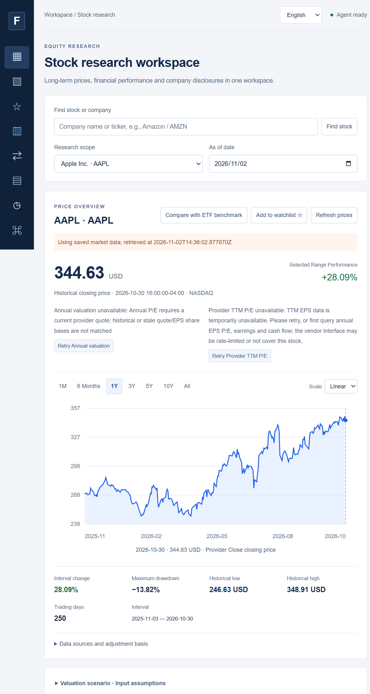

# FilingCopilot

<p align="center">
  <strong>English</strong> · <a href="./README.zh-CN.md">简体中文</a>
</p>

<p align="center">
  <a href="https://github.com/francisown/filingcopilot/actions/workflows/ci.yml"></a>
  <a href="./LICENSE"></a>
  <a href="https://www.python.org/downloads/"></a>
</p>

**Ask a question about a U.S. company filing. Get an answer you can check.**

FilingCopilot is a research workspace for SEC filings that runs on your machine. It finds the relevant annual or quarterly report, pulls the exact passages, calculates the financial figures, and shows the source behind every claim. If the filing does not support an answer, it says so instead of guessing.



*The workspace: price history, filing research and source checks in one place.*

## What it does

- Answers questions about revenue, profit, margins, cash flow, risks and the wording of a filing.
- Numbers are handled by fixed rules and calculations; an AI research agent is used only when a question needs narrative evidence or multi-step reasoning.
- Returns a short answer, the cited passages, code-calculated figures and explicit gaps.
- Can export a complete research package that a standalone verifier checks offline.

## What you can ask

- "What were Apple's FY2025 revenue and net income?"
- "Why did Microsoft's operating margin change?"
- "What regulatory, demand and customer-concentration risks did TSMC disclose?"
- "Did this filing explicitly deny a demand decline?"

## Why it is different

- **Every answer shows its sources.** Each delivered claim points to a filing passage or a code calculation.
- **It says when evidence is missing.** No fluent guess; the answer carries a visible gap or a refusal.
- **You can re-check it offline.** The exported package can be verified without the research model or network.

## Latest snapshot

Latest local run: 2026-11-02, 140 questions, DeepSeek research and Mimo review, four questions processed in parallel. The 100 answerable questions and 40 boundary/policy questions are reported separately.

| What | Result |
|---|---:|
| Answerable questions with a complete answer | **97 / 100** |
| Expected refusals / market-policy cases | **20 / 20 · 20 / 20** |
| Unsupported claims / numeric errors | **0 / 0** |
| Delivered claims with a source citation | **100%** |
| Regression tests | **2,327 passed** |

Three of the 100 answerable questions returned partial answers with explicit gaps; the rest returned complete answers. Latency, token counts, the numeric audit and the exact question IDs are in [Evaluation](docs/evaluation.md). These are engineering measurements, not an independent human accuracy study.

**Speed:** numeric questions are usually answered in under a second; long narrative questions call the model and an independent reviewer, so they can take minutes. The latest model-backed P95 was 842 seconds; see Evaluation for the full breakdown.

## Try it in 60 seconds

Python 3.10 or later is required. The bundled filing example works without an API key or GPU.

### Windows PowerShell

```powershell
.\setup.ps1
if (-not (Test-Path -LiteralPath .env)) { Copy-Item .env.example .env }
$env:FC_EMBEDDING_MODE = "off"
.\start.ps1 -Port 8159
```

Open <http://127.0.0.1:8159/> and select **Apple / AAPL** with **Data only**. Try the bundled package verifier:

```powershell
.\.venv\Scripts\python.exe -m filingcopilot verify-package examples/annual-facts.json
```

### macOS / Linux

```bash
python3 -m venv .venv
.venv/bin/python -m pip install -e "."
cp .env.example .env
FC_EMBEDDING_MODE=off .venv/bin/python -m filingcopilot serve --port 8159
```

The complete setup and troubleshooting steps are in [docs/installation.md](docs/installation.md).

## What you get

For every answer:

- a short conclusion;
- the cited filing passages and/or code-calculated figures;
- explicit gaps for requested parts that are missing;
- an optional research package that can be exported and checked offline.

## How it works

```text
Browser / CLI / REST / MCP
            |
     capability and date scope
            |
 source preparation and filing ingestion
            |
   hybrid retrieval and reranking
            |
 facts, passages and calculations stored with their sources
            |
 fixed checks + independent review
            |
 answer, citations, explicit gaps and an optional research package
```

Fixed rules handle annual figures, growth, margins and trends without a model. Research questions use a tool-calling agent when they need narrative evidence or multi-step calculations. The service is available through the browser workspace, CLI, REST API and 30 MCP tools.

## Who it is for

- Analysts, investors, students and anyone who needs to read filings carefully.
- Local or private workflows: data stays on your machine except the model/API calls you configure.

It is not investment advice, a trading system, a production credit-decision system, or a replacement for reading the filing and independent human review.

## Enable live filings and research

Copy `.env.example` to `.env` and set values locally. Never commit `.env`.

| Variable | Purpose |
|---|---|
| `FC_SEC_USER_AGENT` | Contact name and email required by SEC requests |
| `FC_API_BASE` / `FC_API_KEY` | OpenAI-compatible provider endpoint and private key |
| `FC_MODEL` | Research model; the checked-in example uses DeepSeek |
| `FC_REVIEW_MODEL` | Separate review model; the checked-in example uses Mimo |
| `FC_RESEARCH_TIMEOUT` | Overall time limit for one research run; the public example is 3,000 seconds |
| `FC_WATCHLIST_TRIGGERS_ENABLED` | Optional: scan saved tickers and queue research only when enabled |
| `FC_EMBEDDING_MODE` | `off` for keyword retrieval or `local` for optional local embeddings |
| `FC_EXTRA_HEADERS` / `FC_SESSION_ID` | Optional provider-specific request metadata. OpenCode Go requires a stable `FC_SESSION_ID` (`x-opencode-session`) and its own base URL. |
| `FC_MAX_COST_USD` | Optional ceiling; requires both token prices and is rejected otherwise |
| `FC_MONITORING_SCAN_INTERVAL_MINUTES` | Background scan interval; 0 disables it |
| `FC_MONITORING_DIGEST_*` | Daily digest enable/hour/channel (`local`/`webhook`/`slack`/`smtp`) |
| `FC_SMTP_*` / `FC_SLACK_WEBHOOK_URL` | Email or native Slack delivery configuration |
| `FC_MONITORING_BRIEF_*` | Per-brief model timeout, token and optional cost ceiling |

Model requests may incur provider charges. The application does not place trades. New filing preparation requires network access and a compliant SEC user agent; existing local data can be queried offline.

For an OpenCode Go subscription, use
`FC_API_BASE=https://opencode.ai/inference/go/openai/v1`, a stable
`FC_SESSION_ID`, and the HTTP model ids (`deepseek-v4.1-flash`,
`mimo-v2.6-flash`). The pay-as-you-go base URL and the free-tier models do not
accept a Go key from an external client. See [OpenCode Go](docs/opencode-go.md).

## Disclosure monitoring (Monitor v1)

Monitor v1 turns saved companies into an evidence-first review queue. It scans
US 10-K / 10-Q / 8-K filings, compares structured facts and four targeted
sections, classifies 8-K items deterministically, and creates one filing-level
case with a fixed-format brief. Every fact and calculation carries an evidence
ID; “why it may matter” is labelled as inference.

```powershell
# One-off local scan of saved companies (or pass tickers explicitly)
.\.venv\Scripts\python.exe -m filingcopilot monitor-scan AAPL MSFT

# Review queue and one case
.\.venv\Scripts\python.exe -m filingcopilot monitor-cases
.\.venv\Scripts\python.exe -m filingcopilot monitor-case <case-id>

# Approve / dismiss / reopen (version is required; query the case first)
.\.venv\Scripts\python.exe -m filingcopilot monitor-review <case-id> approve `
  --brief-version 1 --comment "checked"

# Historical replay for a date interval
.\.venv\Scripts\python.exe -m filingcopilot monitor-replay AAPL MSFT `
  --start 2025-01-01 --end 2025-12-31

# Daily digest (markdown) and optional PDF / delivery
.\.venv\Scripts\python.exe -m filingcopilot monitor-digest
.\.venv\Scripts\python.exe -m filingcopilot monitor-digest --pdf digest.pdf
.\.venv\Scripts\python.exe -m filingcopilot monitor-digest --channel smtp

# Offline package verification and delivery
# Verify the exact exported file; do not re-serialize it with ConvertTo-Json.
.\.venv\Scripts\python.exe -m filingcopilot monitor-verify case-package.json
.\.venv\Scripts\python.exe -m filingcopilot monitor-deliver <case-id> --channel local
```

The web case view has a full-text brief editor (headline, narrative, numbers,
inferences, gaps and next checks). Approved versions remain preserved; an edit
creates a new review version. Section changes include character offsets and quote
hashes, and the model polish path is capped to one request by
`FC_MONITORING_BRIEF_TIMEOUT`, `FC_MONITORING_BRIEF_MAX_TOKENS` and optional
`FC_MONITORING_BRIEF_MAX_COST_USD`.

Set `FC_MONITORING_DIGEST_ENABLED=true` and `FC_MONITORING_DIGEST_HOUR=7` for the
daily digest. The next window starts from the cutoff captured before the previous
query (so a previous afternoon's case is included next morning). Channels:
`local`, `webhook` (`FC_MONITORING_WEBHOOK_URL`), `slack`
(`FC_SLACK_WEBHOOK_URL`) and `smtp`
(`FC_SMTP_HOST/PORT/USER/PASSWORD/FROM/TO`). A digest is claimed atomically so a
manual send cannot race the scheduled send. Policies with `notify=false` or
`enabled=false` are excluded. PDF generation uses the bundled ReportLab
dependency.

The first scan is a bootstrap that processes the latest 10-K / 10-Q and the
recent 8-K batch per ticker (last 7 days relative to the newest SEC acceptance).
Later scans use a per-ticker `last_accepted` watermark and process only newer
filings. Every accession has a `pending` / `processed` / `suppressed`
/ `failed` status; a failed accession is retried on the next scan. Use
`--reprocess` only when you intentionally want to rebuild cases that already
exist.

Set `FC_MONITORING_SCAN_INTERVAL_MINUTES=60` to enable the optional background
scan loop in `serve` (0 disables it). Event scoring is available through
`scripts/evaluate_monitor_events.py`; the checked-in seed is synthetic and is
not a substitute for an analyst-labelled pilot set.

```powershell
.\.venv\Scripts\python.exe .\scripts\evaluate_monitor_events.py `
  --gold evaluation\monitor_events_v1.json `
  --predicted monitor-events.json
```

In the browser workspace, open **披露监控**. Live discovery requires
`FC_SEC_USER_AGENT` with a real contact email. Briefs are deterministic by
default; set `FC_MONITORING_USE_MODEL=true` to permit at most one model polish
call per brief (the model may rewrite only the headline and inference bullets).
The full scope, event taxonomy, materiality rules and acceptance gates are in
[Monitor v1](docs/monitoring-v1.md).

## Documentation

- [Architecture](docs/architecture.md)
- [Evaluation and denominators](docs/evaluation.md)
- [Case study](docs/case-study.md)
- [Installation](docs/installation.md)
- [User guide](docs/user-guide.md)
- [Research package protocol](docs/research-package-protocol.md)
- [Independent verifier](docs/independent-verifier.md)
- [Security and threat model](docs/security-threat-model.md)
- [Disclosure monitoring specification](docs/monitoring-v1.md)
- [OpenCode Go API](docs/opencode-go.md)
- [External evaluation datasets](evaluation/external/README.md)
- [Contributing](CONTRIBUTING.md)

## Development

```bash
python -m pip install -e ".[dev]"
python -m pytest -q
python -m ruff check src tests scripts
python -m compileall -q src scripts
```

The external benchmark data and local filing cache are not committed. Review the licenses in [evaluation/external/README.md](evaluation/external/README.md) before fetching non-commercial datasets.

FilingCopilot is an independent engineering project. It is not investment advice, a production credit-decision system, or a certified model.
