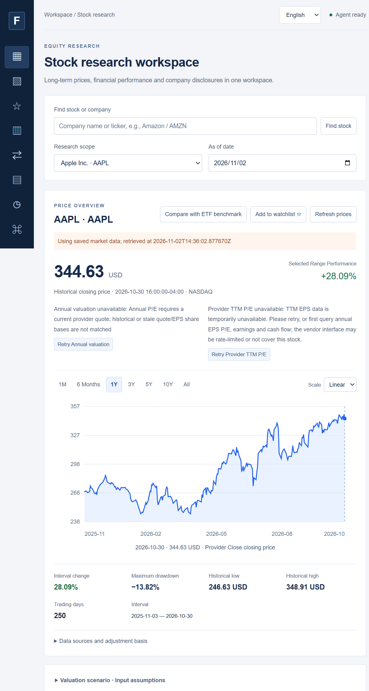

# FilingCopilot

<p align="center">
  <a href="./README.md">English</a> · <strong>简体中文</strong>
</p>

<p align="center">
  <a href="https://github.com/francisown/filingcopilot/actions/workflows/ci.yml"></a>
  <a href="./LICENSE"></a>
  <a href="https://www.python.org/downloads/"></a>
</p>

**针对一份美国公司财报提问，得到一个可以核对的答案。**

FilingCopilot 是一个在本地运行的 SEC 财报研究工作台。它会找到相关年报或季报，抽取原文段落，计算财务数字，并把每个结论的来源展示出来。如果财报里没有足够证据，它会明确说“缺证据”，而不是编一个答案。



*工作台：价格历史、财报研究和来源核对放在同一个页面。*

## 五分钟阅读路径

1. [架构说明](docs/architecture.md)：数据流、证据账本和信任边界。
2. [`agent_execution.py`](src/filingcopilot/agent_execution.py)：工具循环、预算和停止条件。
3. [`verification.py`](src/filingcopilot/verification.py)：声明绑定、数字检查和拒答。
4. [评测](docs/evaluation.md)：覆盖率、延迟、token 和已知限制。
5. [演示脚本](docs/demo-script.md)：三分钟演示；独立人工评测仍待完成，见[人工评测协议](docs/human-evaluation-protocol.md)。

## 它能做什么

- 回答营收、利润、利润率、现金流、风险，以及财报中的具体表述。
- 数字类问题由固定规则和计算处理；只有需要阅读大段原文或多步推理时，才会调用 AI 研究模型。
- 返回简短结论、引用的原文段落、由代码计算出的数字，并明确说明缺少什么。
- 可以导出完整的研究包，让独立验证器在离线状态下复核。

## 你可以问什么

- “苹果 FY2025 营收和净利润是多少？”
- “微软的营业利润率为什么变化？”
- “台积电披露了哪些监管、需求和客户集中度风险？”
- “这份财报是否明确否认需求下降？”

## 为什么不一样

- **每个答案都带出处。** 每个结论都指向财报原文或由代码计算出的结果。
- **缺证据就明说。** 不会用流畅的文字去猜；答案会列出缺口或直接拒答。
- **可以离线复核。** 导出的研究包不需要研究模型或网络，独立验证器就能检查。

## 最新快照

最新本地运行：2026-11-12，140 题，DeepSeek 研究、Mimo 审查，同时并行处理 4 道题。100 道本应能回答的研究题和 40 道边界/策略题分开统计。

| 项目 | 结果 |
|---|---:|
| 本应能回答的题中，给出完整答案 | **98 / 100** |
| 预期拒答 / 行情源策略题 | **20 / 20 · 20 / 20** |
| 无来源支持的结论 / 数值错误 | **0 / 0** |
| 给出的结论都带来源引用 | **100%** |
| 回归测试 | **2,360 passed** |

100 道本应能回答的题中，2 道给出了带明确缺口的部分回答（`negation-013/018`），其余为完整回答；另有 2 条否定题答案偏短，作为质量 caveat 保留。完整延迟数据、token 数、数值审计和具体题目见[评测记录](docs/evaluation.md)。这些是工程和工作流层面的测量，不是独立的人工准确率评估。

**速度：** 数字类问题通常不到一秒；需要阅读大段原文的叙述题会调用模型和独立审查，可能要几分钟。优化前全量模型题 P95 为 842 秒；优化后 140 题重跑为 **P50 121 秒 / P95 465 秒**，可答问题 98/100；非最终 repair 轮跳过 coverage review。仍有 2 条 review `length`、2 条偏短的否定题答案，所以这是速度/coverage 取舍，不是无代价提升。详见[延迟预算](docs/latency-budget.md)。

## 60 秒试用

需要 Python 3.10 或以上。内置财报示例不需要 API Key 或 GPU。

### Windows PowerShell

```powershell
.\setup.ps1 -Language zh
if (-not (Test-Path -LiteralPath .env)) { Copy-Item .env.example .env }
$env:FC_EMBEDDING_MODE = "off"
.\start.ps1 -Port 8159
```

打开 <http://127.0.0.1:8159/>，选择 **Apple / AAPL**，模式选 **只看数据**。验证内置的研究包：

```powershell
.\.venv\Scripts\python.exe -m filingcopilot verify-package examples/annual-facts.json
```

### macOS / Linux

```bash
python3 -m venv .venv
.venv/bin/python -m pip install -e "."
cp .env.example .env
FC_EMBEDDING_MODE=off .venv/bin/python -m filingcopilot serve --port 8159
```

完整安装和故障处理见[安装说明](docs/installation.md)。

## 你会得到什么

每个答案包括：

- 简短结论；
- 引用的原文段落或由代码计算出的数字；
- 如果请求的某部分缺少证据，会明确列出缺口；
- 可选的研究包，可导出并离线复核。

## 它如何工作

```text
浏览器 / CLI / REST / MCP
            |
        能力与日期范围
            |
    资料准备与财报入库
            |
      混合检索与重排
            |
 事实、段落和计算，连同来源一起保存
            |
       固定检查 + 独立审查
            |
 答案、引用、明确缺口和可选研究包
```

年度数字、增长、利润率和趋势这类问题由固定规则处理，不需要模型。只有需要阅读大段原文或多步计算的问题，才会进入 AI 研究流程。浏览器工作台、CLI、REST API 和 30 个 MCP 工具共用同一套服务和证据规则。

## 适合谁

- 分析师、投资者、学生，以及需要认真读财报的人。
- 如果你需要本地或私有部署：除了你自己配置的模型/API 调用，数据留在本机。

它不构成投资建议，不是交易系统，不是生产级信贷决策系统，也不能替代阅读原文和独立人工复核。

## 开启实时资料和研究

把 `.env.example` 复制为 `.env`，只在本机填写真实值。不要提交 `.env`。

| 配置 | 用途 |
|---|---|
| `FC_SEC_USER_AGENT` | SEC 请求所需的联系人和邮箱 |
| `FC_API_BASE` / `FC_API_KEY` | OpenAI 兼容接口地址和私钥 |
| `FC_MODEL` | 研究模型；仓库示例使用 DeepSeek |
| `FC_REVIEW_MODEL` | 独立审查模型；仓库示例使用 Mimo |
| `FC_RESEARCH_TIMEOUT` | 单次研究的总体时间上限；公开示例为 3,000 秒 |
| `FC_WATCHLIST_TRIGGERS_ENABLED` | 自选列表：开启后才会扫描并创建研究任务；关闭时只报告候选 |
| `FC_EMBEDDING_MODE` | `off` 使用关键词检索，`local` 使用可选本地向量 |
| `FC_EXTRA_HEADERS` / `FC_SESSION_ID` | 可选的供应商请求元数据；OpenCode Go 需要稳定的 `FC_SESSION_ID` |
| `FC_MAX_COST_USD` | 单次费用上限；必须同时配置两项 token 单价，否则启动时拒绝 |

监控、早报、SMTP/Slack 和简报预算变量见[披露监控规格](docs/monitoring-v1.md)。

模型请求可能产生供应商费用，应用不会执行交易。准备新的财报需要网络和合规的 SEC 用户代理；已有本地资料可以离线查询。

OpenCode Go 的接口地址是 `https://opencode.ai/inference/go/openai/v1`，模型 ID 用 `deepseek-v4.1-flash`、`mimo-v2.6-flash`，并需要稳定的 `FC_SESSION_ID`。详见 [OpenCode Go 接口](docs/opencode-go.md)。

## 披露监控（Monitor v1）

把自选公司变成可审核的披露队列：扫描美国 10-K / 10-Q / 8-K，比较财务事实和重点章节，按 8-K Item 分类事件，生成带证据的一页简报，并记录人工确认、修改、忽略和反馈。

```powershell
.\.venv\Scripts\python.exe -m filingcopilot monitor-scan AAPL MSFT
.\.venv\Scripts\python.exe -m filingcopilot monitor-cases
.\.venv\Scripts\python.exe -m filingcopilot monitor-review <case-id> approve --brief-version 1
.\.venv\Scripts\python.exe -m filingcopilot monitor-replay AAPL `
  --start 2025-01-01 --end 2025-12-31
.\.venv\Scripts\python.exe -m filingcopilot monitor-digest --pdf digest.pdf
.\.venv\Scripts\python.exe -m filingcopilot monitor-verify case-package.json
```

网页左侧打开 **披露监控**，可以查看队列、编辑全文、审核和导出。完整的扫描、早报、SMTP/Slack、回放、证据定位和评测口径见[披露监控规格](docs/monitoring-v1.md)；OpenCode Go 配置见[接口说明](docs/opencode-go.md)。

## 文档

- [架构说明](docs/architecture.md)
- [评测与分母口径](docs/evaluation.md)
- [延迟与成本预算](docs/latency-budget.md)
- [案例研究](docs/case-study.zh-CN.md)
- [安装说明](docs/installation.md)
- [用户指南](docs/user-guide.md)
- [研究包协议](docs/research-package-protocol.md)
- [独立验证器](docs/independent-verifier.md)
- [安全与威胁模型](docs/security-threat-model.md)
- [远程演示边界](docs/hosted-demo.md)
- [演示脚本](docs/demo-script.md)
- [人工评测与试点协议](docs/human-evaluation-protocol.md)
- [披露监控规格](docs/monitoring-v1.md)
- [OpenCode Go 接口](docs/opencode-go.md)
- [外部评测数据集](evaluation/external/README.md)
- [参与贡献](CONTRIBUTING.md)

## 开发检查

```bash
python -m pip install -e ".[dev,semantic,evaluation]"
python -m pytest -q
python -m ruff check src tests scripts
python -m compileall -q src scripts
```

完整 extras 与 CI 一致。只安装 `.[dev]` 也会正常收集测试；缺少 pandas、fastembed
或 pypdf 时，依赖这些可选包的测试会显式跳过。修改测试后，用
`python scripts/update_validation_counts.py <count> --write` 同步文档中的数字，并用
`--check` 校验。外部评测数据和本地财报缓存不会提交到仓库。获取非商业数据集前，请先阅读[evaluation/external/README.md](evaluation/external/README.md)中的许可说明。

FilingCopilot 是独立工程项目，不构成投资建议，不是生产级信贷决策系统，也不是经过认证的模型。
