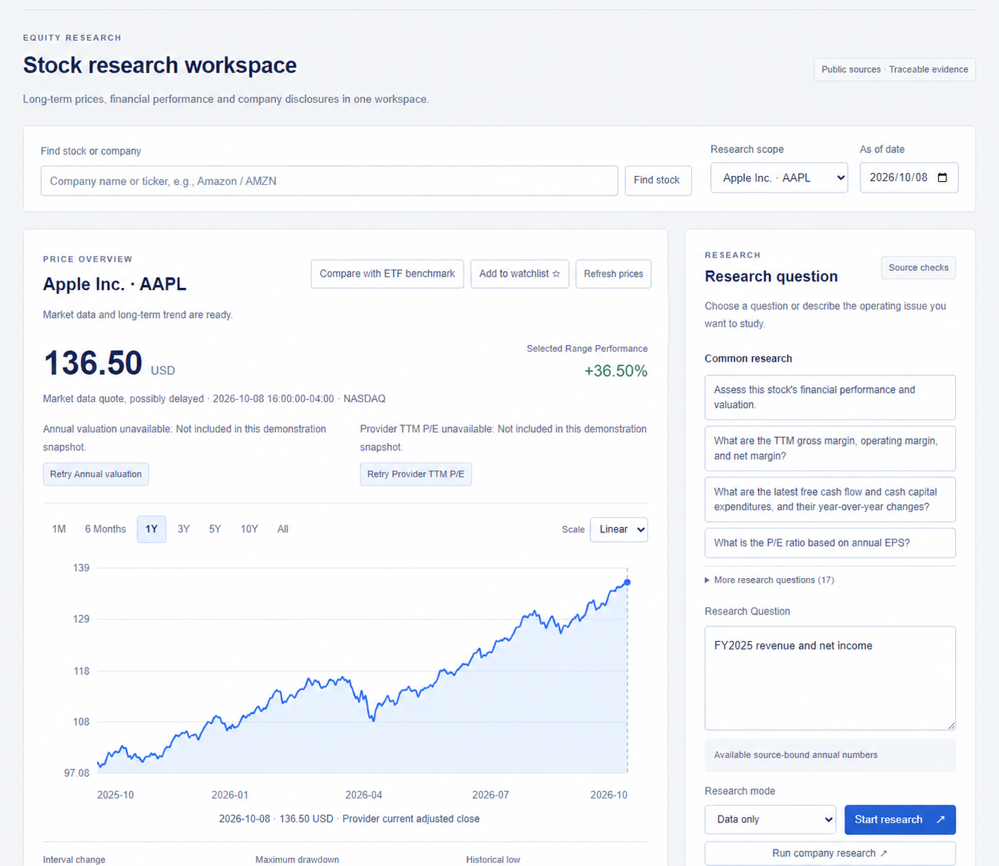

# FilingCopilot

<p align="center">
  <a href="./README.md">English</a> · <strong>简体中文</strong>
</p>

<p align="center">
  <a href="https://github.com/francisown/filingcopilot/actions/workflows/ci.yml"></a>
  <a href="./LICENSE"></a>
  <a href="https://www.python.org/downloads/"></a>
</p>

**问一份美国公司财报，得到一个可以核对的答案。**

FilingCopilot 是一个本地优先的 SEC 财报研究工作台。它会找到相关年报或季报，抽取原文段落，计算财务数字，并把每个结论的来源展示出来。文件不支持的问题，它明确说“缺证据”，不编答案。



## 它能做什么

- 回答营收、利润、利润率、现金流、风险和财报措辞等问题。
- 数值题走确定性路径；只有需要叙述证据或多步研究时才调用 AI 研究 agent。
- 返回简短结论、引用的原文段落、代码计算的数字，以及明确的缺口。
- 可以导出冻结研究包，让独立验证器在离线状态下复核。

## 你可以问什么

- “苹果 FY2025 营收和净利润是多少？”
- “微软的营业利润率为什么变化？”
- “台积电披露了哪些监管、需求和客户集中度风险？”
- “这份财报是否明确否认需求下降？”

## 为什么不一样

- **结论带出处。** 每个交付的结论都指向财报原文或代码计算。
- **缺证据就说缺。** 没有足够支持时明确列出缺口或拒答，不用流畅的文字猜。
- **可以离线复核。** 导出的研究包不需要研究模型或网络，独立验证器就能检查。

## 最新快照

最新本地运行：2026-11-02，140 题，DeepSeek 研究、Mimo 审查，四个 worker。100 道应回答研究题和 40 道边界/策略题分开统计。

| 项目 | 结果 |
|---|---:|
| 应回答题目中给出完整答案 | **97 / 100** |
| 预期拒答 / 行情策略题 | **20 / 20 · 20 / 20** |
| 无来源声明 / 数值错误 | **0 / 0** |
| 已交付结论带来源引用 | **100%** |
| 回归测试 | **2,307 passed** |

其余 3 道应回答题目给出带明确缺口的部分回答。完整延迟、token、数值审计和具体题目见[评测记录](docs/evaluation.md)。这些是工程和工作流测量，不是独立人工准确率研究。

**速度：** 确定性数值题通常亚秒级；长叙述题会调用模型和独立审查，可能需要数分钟。最新模型题 P95 为 842.1 秒，完整拆分见评测记录。

## 60 秒试用

需要 Python 3.10 或以上。内置财报示例不需要 API Key 或 GPU。

### Windows PowerShell

```powershell
.\setup.ps1 -Language zh
if (-not (Test-Path -LiteralPath .env)) { Copy-Item .env.example .env }
$env:FC_EMBEDDING_MODE = "off"
.\start.ps1 -Port 8159
```

打开 <http://127.0.0.1:8159/>，选择 **Apple / AAPL** 和 **只看数据**。验证内置研究包：

```powershell
.\.venv\Scripts\python.exe -m filingcopilot verify-package examples/annual-facts.json
```

### macOS / Linux

```bash
python3 -m venv .venv
.venv/bin/python -m pip install -e "."
cp .env.example .env
FC_EMBEDDING_MODE=off .venv/bin/python -m filingcopilot serve --port 8159
```

完整安装和故障处理见[安装说明](docs/installation.md)。

## 你会得到什么

每个答案包含：

- 简短结论；
- 引用的原文段落和/或代码计算的数字；
- 请求中缺失部分对应的明确缺口；
- 可选的可导出研究包和离线验证器。

## 它如何工作

```text
浏览器 / CLI / REST / MCP
            |
        能力与日期范围
            |
    资料准备与财报入库
            |
      混合检索与重排
            |
  证据账本中的事实、段落和计算
            |
       确定性检查 + 独立审查
            |
 答案、引用、明确缺口和可选研究包
```

年度数字、增长、利润率和趋势等确定性问题不需要模型。需要叙述证据或多步计算的问题才进入工具调用研究流程。浏览器工作台、CLI、REST API 和 30 个 MCP 工具共用同一套服务和证据规则。

## 适合谁

- 分析师、投资者、学生，以及需要认真读财报的人。
- 本地或私有流程：除了你自己配置的模型/API 调用，数据留在本机。

它不构成投资建议，不是交易系统，不是生产级信贷决策系统，也不能替代阅读原文和独立人工复核。

## 开启实时资料和研究

把 `.env.example` 复制为 `.env`，只在本机填写真实值。不要提交 `.env`。

| 配置 | 用途 |
|---|---|
| `FC_SEC_USER_AGENT` | SEC 请求所需的联系人和邮箱 |
| `FC_API_BASE` / `FC_API_KEY` | OpenAI 兼容接口地址和私钥 |
| `FC_MODEL` | 研究模型；仓库示例使用 DeepSeek |
| `FC_REVIEW_MODEL` | 独立审查模型；仓库示例使用 Mimo |
| `FC_RESEARCH_TIMEOUT` | 协作式研究上限；公开示例为 3,000 秒 |
| `FC_WATCHLIST_TRIGGERS_ENABLED` | 自选列表触发需显式开启；关闭时只报告候选，不创建任务 |
| `FC_EMBEDDING_MODE` | `off` 使用关键词检索，`local` 使用可选本地向量 |
| `FC_EXTRA_HEADERS` / `FC_SESSION_ID` | 可选的供应商请求元数据 |
| `FC_MAX_COST_USD` | 单次费用上限；必须同时配置两项 token 单价，否则启动时拒绝 |

模型请求可能产生供应商费用，应用不会下单交易。准备新的财报需要网络和合规的 SEC 用户代理；已有本地资料可以离线查询。

## 文档

- [架构说明](docs/architecture.md)
- [评测与分母口径](docs/evaluation.md)
- [案例研究](docs/case-study.zh-CN.md) · [Case study](docs/case-study.md)
- [安装说明](docs/installation.md)
- [用户指南](docs/user-guide.md)
- [研究包协议](docs/research-package-protocol.md)
- [独立验证器](docs/independent-verifier.md)
- [安全与威胁模型](docs/security-threat-model.md)
- [外部评测数据集](evaluation/external/README.md)
- [参与贡献](CONTRIBUTING.md)

## 开发检查

```bash
python -m pip install -e ".[dev]"
python -m pytest -q
python -m ruff check src tests scripts
python -m compileall -q src scripts
```

外部评测数据和本地财报缓存不会提交到仓库。获取非商业数据集前，请先阅读[evaluation/external/README.md](evaluation/external/README.md)中的许可说明。

FilingCopilot 是独立工程项目，不构成投资建议，不是生产级信贷决策系统，也不是经过认证的模型。
