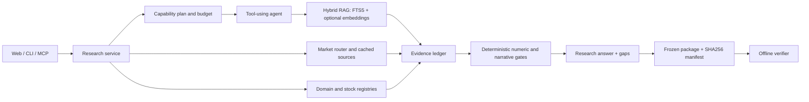

# Architecture and trace

The web UI, CLI, REST API and MCP server share a research service. It prepares
evidence, runs calculations or model-assisted research, verifies the submitted
claims and saves the result with its sources.

A sample end-to-end trace shows one cited fact, its calculation/rendered
answer, the frozen domain, and the zero-model standalone verification. The
verification report matches the local corpus and the original filing hash. A consistent package
proves only the checks that were requested, not that a narrative or investment
decision is correct.

Before semantic review, narrow narrative checks reject explicit currency-direction
conflicts and attempts to infer document-wide absence from selected passages.
Correctly scoped uncertainty and directly disclosed negative facts remain eligible
for review. The reviewer receives the original claim plus its individual sentences
and checks subject, direction, period, materiality and evidence scope. This remains
a model judgment; passing it does not certify correctness.

An explicit cause or risk request cannot be completed by submitting only financial
figures. Valid figures are retained with an explanation gap, and the existing repair
budget can be used to supply the missing prose. Presence of prose alone does not
prove that every requested aspect has been answered; content evaluation checks
that separately.

The company workspace is an evidence browser: its nine sections, annual
figures, peers, quarter sequence and structured statement rows do not silently
generate model opinions. Each section can start its own module summary: the
contract (`question`, `kind`, `boundary`, `empty_gap`) lives in
`company_modules.py`, the model brief is appended only when the request carries
that module, and submissions are bounded (one to three statements) before the
ordinary numeric and semantic verification. A separate report action starts the
reviewed company report. Quote requests are independent of this source page.
Each asynchronous response must still match the current company, knowledge date
and, for statement rows, selected report version and statement.

The standalone cashflow sensitivity surface uses `filingcopilot.dcf/v2`.
Its REST boundary matches OCF, gross cash PP&E purchases and an instant ordinary
share count to the same available annual filing before doing arithmetic.
The exported calculation keeps those inputs and user assumptions, but it is
not a v1 research package. OCF less gross PP&E is a cashflow proxy, not unlevered
FCF: the surface does not call the result enterprise value or an equity target.

`reranking.py` is an evaluation-only seam. Invalid score counts, nonfinite
scores or scorer failures preserve the original order and evidence objects.
The candidate evaluator requires complete frozen-ID coverage, no failed
questions, strict recall and MRR improvements, and acceptable latency before
marking a candidate eligible for integration. Eligibility alone does not change
runtime defaults or establish human semantic accuracy.
