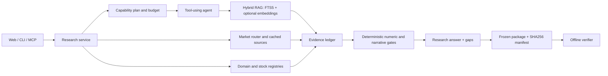

# Architecture and trace

The web UI, CLI, REST API and MCP server share a research service. It prepares
evidence, runs calculations or model-assisted research, verifies the submitted
claims and saves the result with its sources.

A sample end-to-end trace shows one cited fact, its calculation/rendered
answer, the frozen domain, and the zero-model standalone verification. The
verification report matches the local corpus and the original filing hash. A consistent package
proves only the checks that were requested, not that a narrative or investment
decision is correct.

Before semantic review, narrow narrative checks reject explicit currency-direction
conflicts and attempts to infer document-wide absence from selected passages.
Correctly scoped uncertainty and directly disclosed negative facts remain eligible
for review. The reviewer receives the original claim plus its individual sentences
and checks subject, direction, period, materiality and evidence scope. This remains
a model judgment; passing it does not certify correctness.

An explicit cause or risk request cannot be completed by submitting only financial
figures. Valid figures are retained with an explanation gap, and the existing repair
budget can be used to supply the missing prose. Presence of prose alone does not
prove that every requested aspect has been answered; content evaluation checks
that separately.

The company workspace is an evidence browser: its nine sections, annual
figures, peers, quarter sequence and structured statement rows do not silently
generate model opinions. Each section can start its own module summary: the
contract (`question`, `kind`, `boundary`, `empty_gap`) lives in
`company_modules.py`, the model brief is appended only when the request carries
that module, and submissions are bounded (one to three statements) before the
ordinary numeric and semantic verification. A separate report action starts the
reviewed company report. Quote requests are independent of this source page.
Each asynchronous response must still match the current company, knowledge date
and, for statement rows, selected report version and statement.

The standalone cashflow sensitivity surface uses `filingcopilot.dcf/v2`.
Its REST boundary matches OCF, gross cash PP&E purchases and an instant ordinary
share count to the same available annual filing before doing arithmetic.
The exported calculation keeps those inputs and user assumptions, but it is
not a v1 research package. OCF less gross PP&E is a cashflow proxy, not unlevered
FCF: the surface does not call the result enterprise value or an equity target.

Retrieval produces bounded candidates from independent legs: FTS5 lexical
matching, section/title matching, explicit reporting-period matching, optional
coverage scoring, and optional dense embeddings. The legs are deduplicated and
fused with weighted reciprocal-rank scores; each leg is capped by
`retrieval_candidate_limit`, while the union is allowed to contain candidates
from multiple legs. `lexical_only=True` never runs the dense leg. Coverage is
available for the `coverage` rerank mode and is evaluated over the scoped
candidate set, capped at 10,000 passages; it never silently replaces the other
legs or scans an unbounded global corpus. Backend
labels list the legs actually used (for example `fts5+title+period+coverage`);
diagnostics carry per-source candidate counts and scan counts. `reranking.py`
remains an evaluation-only seam. Invalid score counts, nonfinite scores or
scorer failures preserve the original order and evidence objects.
The candidate evaluator requires complete frozen-ID coverage, no failed
questions, strict recall and MRR improvements, and acceptable latency before
marking a candidate eligible for integration. Eligibility alone does not change
runtime defaults or establish human semantic accuracy.

The default second stage now preserves the original question terms in every
causal, risk and negation sub-query, then applies a bounded diversity pass to
the top 20 near candidates. Search results also expose a deterministic
`evidence_slot_plan` (period, driver, counterevidence, concentration, and so on)
so the agent can search the first unresolved part instead of repeating a broad
query. This is planning metadata, not evidence: only the verified ledger can
promote a passage into an answer claim.

Before a scoped passage search, the service checks whether the requested issuer
and fiscal period are actually present in the local corpus. If the scope is
missing and an SEC source is supported, it prepares only that annual or
quarterly filing set, then reruns the same bounded retrieval. A failed refresh
is returned as a warning and leaves the answer unsupported; it never widens the
scope or invents a substitute document.

Search responses are projected separately at the author-model boundary: source
text, IDs and locators remain, while ranking diagnostics stay in the trace; the
same passage is not resent verbatim on later rounds. The evidence ledger and
exported research package retain the complete objects.

Narrative prefetch uses the question shape to decide which evidence slots are
required. Regulatory, demand and supply/operations risk are general risk slots;
customer concentration is added only when the question asks for concentration or major
customer exposure. This keeps an absent, unrequested disclosure from turning an
otherwise supported risk answer into a false partial result. The submit schema
also caps narrative answers at five independently supportable claims, so the
model cannot silently turn several unrelated categories into one compound claim
that must be repaired later. When a filing supports a qualitative concentration
risk but does not provide a customer or supplier percentage, the missing number
remains visible as a caveat without being mistaken for a missing risk category.
For an explicit concentration request, the same filing's focused structured
statement rows are prefetched alongside prose passages. Narrative verification
accepts those rows as source-bound support for a qualitative claim, while still
rejecting invented percentages or treating an absent row as zero. If a submitted
cause or risk answer contains only verified figures, one filing-scoped gap search
is attempted before the bounded repair turn so the author can use missing source
text rather than repeatedly guessing.

If review still removes every explanatory sentence from a numeric-only cause or
risk draft, execution retains a few exact passages from that same filing. Those
passages are labeled as source excerpts and the answer remains partial; the
fallback cannot manufacture a causal conclusion. Causal excerpt selection favors
MD&A, margin, segment-driver and operating-expense passages, while risk and
negation questions keep separate topic slots.
