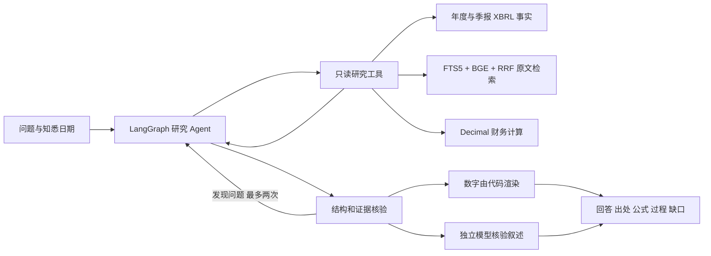

# Complete user guide and historical implementation notes

The material below preserves the previous README. Historical release and evaluation claims keep their original scope; use the root README for the current entry point.

For current Python selection, core installation and port 8159 startup, use the
[installation guide](installation.md). Commands and port numbers below are retained
historical notes, not the current first-run instructions.

# FilingCopilot

> Evidence-first financial research for filings, market data and source-bound
> company analysis.

**Release 1.0.0**

**Measured cold preparation speedup, same model weights and API:**

| Real SEC, no research LLM | Earlier | Current | First numbers at API |
|---|---:|---:|---:|
| PDD | 202.7s | **66.0s** | 14.9s |
| BABA | 243.5s | **61.5s** | 17.6s |

These are two measured cases with empty filing/corpus/vector caches, existing
model weights and direct SEC HTTPS. First numbers means API availability, not
browser painting or model answer time. OS caches were uncontrolled; this is not
a clean-machine install or a universal latency promise.

FilingCopilot combines a tool-using agent, hybrid retrieval (SQLite FTS5 plus
optional local embeddings), deterministic financial calculations, independent
claim gates, REST/CLI/MCP interfaces, and a frozen research-package protocol.
It keeps source identity, public dates, periods, currencies, formulas and gaps
visible instead of turning missing data into confident prose.

The application saves each acquired annual report immediately and displays verified
numbers while cold indexing continues, with real report/index counts and
partial-failure recovery. Earlier fresh-corpus SEC API checks showed the first numbers
at 14.91s (PDD) and 18.78s (BABA); complete preparation then took 203/243s.
These two cases reuse existing model weights and are not a universal browser
or model-response latency promise. New offline human-review pages leave all
labels empty; an optional verifier checksum badge states its mechanical scope.
Version mismatch/source drift blocks new tasks. See the
[test profiles](test-profiles.md) and [verifier integration article](add-verifiable-layer-to-financial-agent.md).

The application provides source-verified cached annual previews before model/source work,
registered CNY annual facts for PDD/BABA/JD, and an independently installable
offline verifier wheel. Focused bilingual queries with 75 candidates improve
the same frozen 200-question exact-passage control from recall@5/MRR
`0.155/0.084333` to `0.260/0.150333`; the doubling target is still unmet.
Cached numbers do not confirm the latest filing, and these retrieval scores
are not human semantic accuracy. See the
[independent verifier instructions](independent-verifier.md).

## Quick start

```powershell
python -m pip install -e ".[dev]"
copy .env.example .env
filingcopilot serve --port 8123
```

Open `http://127.0.0.1:8123`. To run the same service in one command, set the
optional `FC_*` values in `.env` and run `docker compose up --build`.

## What is implemented

- source-bound annual and quarterly filing facts, calculations, trends and
  period/currency checks;
- long-range market charts, watchlists, comparisons, benchmarks, valuation
  snapshots, editable EPS scenarios and source-matched cashflow sensitivity;
- company research pages, recent official updates, contrarian evidence, peers,
  multi-turn evidence history and budget-aware partial answers;
- an MCP server plus REST and CLI entry points sharing the same evidence ledger;
- exportable packages that can be checked offline with
  `filingcopilot verify-package package.json` without an LLM or network.

The supported market and filing scope is explicit in the UI and in each
research package. “Consistent” means the requested structural, arithmetic and
source-cache checks passed; it is not a semantic truth certificate or an
investment recommendation. See [`docs/architecture.md`](architecture.md)
and the [research-package protocol](research-package-protocol.md).

Market cross-checks compare the two suppliers' same-day Close values, while
retaining the independently dated latest quote. New snapshots preserve a
compact secondary-source reference so offline audits can replay conflicts and
source warnings from both raw responses. Missing secondary originals and
legacy references are explicitly `not_checked`.

### Company workspace

Select a company in the workbench and open **公司研究**. The page loads annual
figures and nine source sections independently of quotes. Business and risk
materials are scoped to the latest publicly available annual filing and its
chapter; other operating materials use the latest available financial filing.
Repeated paragraphs are deduplicated. Read or refresh all sources, retry one
section, or press **generate all section summaries** to run every module below
one at a time: each card shows its full text as soon as that item finishes,
already-delivered items are skipped on a later run, and clicking the button
while the batch runs stops it after the current item. The six-topic full
company report remains available from the workbench research panel.

Each of the nine sections also carries its own summary contract. The action sends
that section's module question and renders a fixed format: conclusion → evidence
and periods → boundary → missing information. Analysis modules (business model,
operating changes, cash flow, debt, risk, valuation) deliver reviewed qualitative
statements; restatement modules (recent events, listed shares and currency, audit
report) only restate the original text without operating judgement. The boundary
line is rendered verbatim from the module registry, submissions that exceed the
module's statement count or length cap are sent back for repair instead of being
trimmed, and missing sources produce the section's specific gap text rather than
generic prose. Statements read as one short article with per-paragraph citations
and one review note per label group; while a summary runs only its own button
shows a busy marker (other buttons explain the wait instead of appearing
frozen), and a failed model run keeps its own reason in the gaps instead of
claiming the section lacks sources. A key-figures strip between the statements
and the boundary lists the verified amounts and ratios the statements rely on
(up to eight, each with its period and source); the prose itself stays free of
raw figures. Summaries keep generating while you switch to other workspace
views: re-entering the page keeps the running status in place and restores
delivered summaries instead of reloading the page, and the all-modules batch
keeps going until you stop it or it finishes.

Company sources, peer candidates, supported actions and the filing catalog
render as each request finishes. A slow peer lookup does not hold back ready
figures or source sections; the status names the remaining requests. Refreshing
the catalog preserves an available selected filing. Late results from an older
load or company/date selection are discarded.

The page also reports the actual filing forms and update-source state used for
the selected company. This matters because a useful conclusion may need more
than the latest 10-K: operating changes can use the latest 10-Q and dated
8-K/EX-99.1 material, while events can use explicitly registered 6-K, issuer
transcripts, news, HKEX or CNINFO sources. Segment history, structured guidance,
unregistered foreign-market filings and arbitrary PDFs remain gaps until a
source is configured and independently archived; the system does not infer
them from a nearby filing.

The same page lets you select candidate peers before opening a comparison,
browse source-disclosed single-quarter figures, choose a filing version and
statement, and filter segment/other dimensional rows. Dates and evidence links
stay visible. The quarterly sequence uses explicit 10-Q quarters: annual fourth
quarters are not derived here and the dates may be discontinuous. Missing rows
are never filled with zero. Structured rows are source material, not new typed
financial metrics or a guarantee that every segment is covered.

The cashflow sensitivity form appears only after annual operating cashflow,
gross cash PP&E purchases and ordinary shares outstanding can be matched to
the same filing. Growth, discount and terminal-growth assumptions remain
editable. The `/api/valuation/dcf` response is now `filingcopilot.dcf/v2`:
`inputs` replace unverified `facts`, and `cashflow_present_value` replaces
`enterprise_value`. The OCF-minus-gross-PP&E proxy is not unlevered enterprise
FCF; its per-common-share PV is not an equity target price or an ADS valuation.
Arbitrary IDs, wrong currencies, unavailable dates and weighted-average share
denominators are rejected. Export includes inputs, assumptions, sources and
full-precision arithmetic; this standalone calculation JSON is separate from
the frozen research-package protocol.

Optional neural candidates can be measured with
`python scripts/evaluate_retrieval_candidates.py --output artifacts/candidate.json`.
The script requires the `semantic` extra, checks the frozen corpus IDs, and
reports cold setup, warm latency, recall/MRR and failures. It does not change
runtime defaults. Initial candidate downloads failed; those fallback scores
are **not valid neural comparisons**. Later fixed snapshots were downloaded
and evaluated on all 200 frozen questions. Neither candidate passed the joint
recall/MRR/latency gate, so neither was enabled. The subsequent full-pool
rerank ablation and its limitations are documented in
[the negative-result report](rerank-negative-result-2026-10-11.md).
Human blind labels and independent-market production entitlement
remain external prerequisites.

### Test profiles and timing scope

Run `python scripts/run_quality_checks.py --profile unit --output artifacts/unit.json`
for the `pytest -m "not slow"` rule gate. Integration, concurrency, timeout,
subprocess and database/application tests carry the registered `slow` marker.
CI runs both this gate and the complete collection. Unit-gate success alone
does not validate network, model, browser or integration behavior.
The name describes a selected unit/rule subset relative to the full collection,
not an absolute speed promise. `fast` remains a legacy alias for older commands;
new reports record it as `unit`. A separate environment measured this same
203-test subset at approximately 105/107s in a sandbox; our historical 6.394s
and that measurement describe different environments.

Run `python scripts/run_quality_checks.py --profile full --cache-state both --output artifacts/full.json`
for separate cold-fixture and warm-rerun timings, exact commands and logs.
The first run creates empty fixture/application directories and pytest cache;
the second reuses pytest/host cache with fresh fixture directories. Installed
dependencies and model weights already exist; OS file cache is uncontrolled.
Neither timing is a clean-machine installation or cold model-download test.

The historical **143.77s** full run used a prepared Python 3.10.11 `.venv`.
Separate measurements report **about 24 minutes** with Python 3.13.14 and
**more than 20 minutes without completion** with the project Python 3.10.11.
Those slower observations remain part of the test records; their exact
cache state was not controlled. Local timings are not a universal runtime
promise.

## Public-release notes

This project is released under the [MIT License](../LICENSE). It is provided for
research and education and does not constitute investment, tax, accounting or
legal advice. Do not use it to place trades. Keep API keys in local environment
variables; the repository does not require a personal SEC user-agent by
default—set `FC_SEC_USER_AGENT` to your own contact string before online SEC
requests. Configure `FC_REVIEW_MODEL` to a different model from `FC_MODEL`.

The semantic evaluation set is run through the configured research and review
models and its failures are retained. Human blind labeling is a separate
calibration step and is **not yet completed**; the repository includes
`scripts/export_semantic_blind_sample.py` to export a fixed claim-level sample
without model status or review verdicts, and
`scripts/score_semantic_blind_labels.py` to calculate rates only after a
reviewer fills the labels. Use `--home` plus a separately stored
`--review-key` for the claim-level frozen evidence hash and the independent
review verdict; never give that key to the blind reviewer. The current blank
worksheet is explicitly recorded as `awaiting_human_labels`; the report also
keeps a separate review miss-rate field that stays null until labels are
complete. Do not read the automated score as a human review accuracy estimate.
Worksheet IDs must be unique nonempty strings. Duplicate or malformed IDs do
not contribute to review denominators, and a declared frozen sample size must
match the worksheet. Only `narrative` and `analysis` claims can enter semantic
review calibration; a verification marker on a deterministic fact, calculation
or excerpt does not qualify it. Missing human labels still produce no miss rate.
The frozen 20-claim worksheet contains only three `analysis` claims (13 facts,
three calculations and one market claim are also sampled). Filling all 20 rows
therefore supplies at most three semantic-review calibration cases, not 20.
The original live 140-question tight-budget baseline and its row-level
failure records, the current 20-claim worksheet and its blank report, are
retained in the development archive.
Its main run used 20 seconds; sixteen diagnostic replays used 30 seconds, so it
is explicitly **non-homogeneous**. A separate corrected tight-budget report
preserves all original answers and files, but recovers 101 missing timeout flags
from saved deadline messages. It records 108 timeout rows, 13.04% eligible-answer
coverage and 18.84% evidence-ID binding. Refusal rates use only the 10 non-timeout
refusals: 4 classified wrong and 6 classified reasonable against the question
set's expected behavior. These small denominators and mechanical classifications
are not human quality estimates. Zero recorded unbound IDs or numeric verifier
failures does not prove that the answers are true.

The fresh production-budget run completed all 140 questions
with 240-second research / 60-second model budgets and configured research
and review models. The full comparison retains
the old answers and uses all 140 questions in the coverage denominator:

| Mechanical measure | Tight budget (mixed 20/30s) | Production budget (240/60s) |
| --- | ---: | ---: |
| Answered / partial / abstained | 20 / 8 / 112 | 40 / 67 / 33 |
| Answered above frozen character minimum | 18 / 140 (12.86%) | 37 / 140 (26.43%) |
| Explicit timeout rows | 108 | 16 |
| Evidence-ID binding, legacy eligible-row denominator | 18.84% | 75.91% |
| P50 / P95 elapsed seconds | 20.02 / 30.01 | 135.93 / 240.03 |
| Non-timeout refusals classified wrong / reasonable | 4 / 6 (10 rows) | 25 / 6 (31 rows) |
| Human semantic citation / review miss rates | Unknown | Unknown |

The legacy scorer's coverage is 13.04% / 27.01% because it excludes two / three
short answers from the denominator. Those include concise deterministic ratios;
the frozen length rule is a mechanical guard, not a human completeness judgment.
The new comparison preserves their IDs and does not pad answers for credit.
Longer budgets improved observed delivery, but coverage remains low, partial
answers remain common, and non-timeout refusal classifications expose further
gaps. Recorded unbound-ID and numeric-verifier failure rates were zero in both
runs; that does not establish truthful explanations, full coverage or investment
accuracy. USD cost was unavailable. Model variability, refreshed corpus data
and the mixed old budget prevent a causal budget-only conclusion.

The completed baseline freezes source revision `a1881d4`, before the subsequent
raw-passage compatibility and cold-index deadline fixes. One captured cold search
took 323.05s, making its research take 369.55s despite a 240s budget; P95 hides
that outlier. The diagnosis and real ONNX replay record the
subsequent bounded-batch fix. Cancellation remains cooperative between ONNX
batches, not a hard real-time guarantee. This baseline is not a post-fix rerun.
Checkpoints bind frozen questions, source hash, models, budgets and public
configuration in a manifest; `--resume` refuses missing or mismatched provenance
and duplicate rows. Saved rows are written atomically.

The current versioned retrieval calibration set is
[`retrieval_gold_v2.json`](../evaluation/retrieval_gold_v2.json): 200 bilingual,
five-company questions with real frozen-corpus passage IDs. Its latest FTS5 vs
lexical baseline is recorded in the retrieval-gold-v2 validation report.
That report records the 200-question lexical baseline, the local-embedding RRF
replay, deterministic Unicode/domain query rewriting, and the anchor reranker.
With the current rewrite and the calibrated anchor coverage weight (`0.05`),
the frozen-set replay reached recall@5/MRR `0.260/0.150333`; the earlier
weight-`0.01` local replay had recorded `0.145/0.078500` against the RRF
baseline `0.100/0.051250` (P95 was 64.545 ms after warm-up). The calibrated anchor
reranker is enabled by default. Its absolute numbers remain corpus-anchored
calibration results, not semantic or investment-accuracy claims. Persistent
per-passage caching and a bounded in-process scope cache prevent overlapping
searches from rewriting whole matrices.

The candidate environment has now been restored with pinned, hash-checked local
snapshots. Both cross-encoder and multilingual trials
completed all 200 frozen questions with no setup or inference failures:

| Path | Recall@5 | MRR@5 | P95 ms |
| --- | ---: | ---: | ---: |
| Rewritten FTS5 + anchor, neural trial control | 0.125 | 0.071500 | 73.66 |
| English BGE hybrid + anchor, neural trial control | 0.145 | 0.077667 | 93.87 |
| MiniLM cross-encoder on eight scoped candidates | 0.095 | 0.040833 | 794.10 |
| Multilingual MiniLM hybrid + anchor | 0.140 | 0.079083 | 13,112.13 |

The multilingual trial's separate FTS5 / hybrid control P95 was 58.12 / 76.03ms.
Combined first-scope warm-up/setup took 0.81s for the neural trial and 36.51s
for the multilingual trial; model downloads are excluded. Multilingual per-query
timing includes first-time scope indexing. Trials shared the local host while
other verification was running, so these are observed timings, not a benchmark
on isolated hardware. Neither candidate meets the joint recall/MRR improvement
and 1,000ms P95 gate. Both remain evaluation-only; production retains English
BGE and anchor. The proposed recall-doubling goal remains unmet. These are
editorial, corpus-anchored calibration results, not human semantic accuracy.

To reproduce the verified snapshot setup without the SDK's downloader, run:

```powershell
python -m scripts.download_retrieval_candidates cross-encoder --destination .filingcopilot/models/cross-encoder-local --direct
python -m scripts.download_retrieval_candidates multilingual --destination .filingcopilot/models/multilingual-local --direct
python -m scripts.evaluate_retrieval_candidates --cross-encoder-path .filingcopilot/models/cross-encoder-local --output artifacts/neural-local.json
python -m scripts.evaluate_retrieval_candidates --embedding-model sentence-transformers/paraphrase-multilingual-MiniLM-L12-v2 --embedding-model-path .filingcopilot/models/multilingual-local --output artifacts/multilingual-local.json
```

Omit `--direct` to use the configured proxy. A stale process proxy can differ
from current Windows settings; this run's inherited port 1142 failed while
current direct HTTPS worked. TLS certificate verification remains enabled.
Missing or corrupted local snapshots make candidate evaluation exit with code 2
and an explicit invalid comparison, never a passing score for the fallback.
Snapshot hashes detect local corruption and separate model revisions in the
vector cache; they are not independent publisher signatures. The fixed sources
are the [Xenova export](https://huggingface.co/Xenova/ms-marco-MiniLM-L-6-v2/commit/a09144355adeed5f58c8ed011d209bf8ee5a1fec)
and [Qdrant multilingual export](https://huggingface.co/Qdrant/paraphrase-multilingual-MiniLM-L12-v2-onnx-Q/commit/faf4aa4225822f3bc6376869cb1164e8e3feedd0),
using [FastEmbed's reranking interface](https://qdrant.tech/documentation/fastembed/fastembed-rerankers/).
Neural query rewriting and both candidate runtime paths remain unintegrated.

The rest of this file is the Chinese operator guide and historical acceptance
appendix.

从 SEC 年报出发，完成有来源、有计算过程、可复核的财务研究。这个版本重新设计了产品和代码，原来的项目设计文档只作为历史参考。

提供中文研究工作台、CLI、REST API 和标准 MCP Server。实际使用 LangGraph Agent、FTS5 + 本地 BGE 向量混合 RAG、独立叙述核验和确定性财务计算。

增加可审查的自动同行候选：按本地版本化候选名录和当前已登记证券确定同行，冻结名录版本、候选依据和未参与代码；自动比较仍分别核验报价、供应商 TTM EPS、币种与共同日期走势，不把候选组当作正式行业分类或贵贱结论。增加历史年度市盈率参照：按每个交易日之前已经公开的年度稀释 EPS 与同口径日线计算，过期、亏损、币种/股份不符及后续拆股的日期留空，统计和缺口随研究包保存，支持自由提问、REST、CLI 和 MCP。网页增加候选同行说明和历史市盈率分位卡，旧研究包仍按原 schema 复核。正式行业分类仍未接入；历史年度市盈率不是 TTM、预测或投资建议。

将明确的多公司 TTM 数字比较接入自由提问、CLI 和 MCP 的研究入口。例如“比较微软和亚马逊的 TTM 每股收益和市盈率，近五年走势”会获取当前估值并打开公司对比；没有指定图区间时使用五年。输入 2–4 家已登记公司的明确名称或上市代码；未登记公司可先在“公司对比”中选择上市证券并自动准备年报。支持一年、五年和全部历史走势，TTM 估值使用今天的供应商版本。附带展示已缓存年度数字，本次不检查年报新版本；需要更新年报时可在公司对比中勾选“自动检查与准备年报”。未匹配名称、重复公司、多个上市证券或不支持的区间在开始前提示；不丢弃未识别的公司。股票搜索、提问计划与核验共用证券名录中的明确别名，亚马逊中文名称不再需要模型翻译。该入口提供数值、来源和口径，不把比较倍数自动称作贵贱；混合经营解释、自动同行和历史／预测 EPS 比较仍待扩展。

增加可选的“TTM 估值对比”：为所选公司单独列出供应商 TTM 稀释 EPS、市盈率、报价日、期末标签及获取时间，点击数字可查看原始响应和计算输入。市盈率绑定同一列的股票报价，不另取另一份价格；亏损、零 EPS、币种、时效或拆股口径不匹配时保留已有资料并标出缺口。年度财务表仍按各公司实际财年，和 TTM 分开。历史日期不使用今天的 EPS，未匹配股份类别的证券也不套用其他上市市场的数据。此次真实 AMZN、MSFT、META 对比及网页导出已核对；供应商期末标签不同会直接显示，不能据倍数高低自动判断贵贱。

在研究判断旁显示“所引数据期间”：财年与实际起止日期、本期和对比期、单季度与累计现金流、SEC TTM 窗口、供应商 TTM 期末标签及交易所报价日分别呈现。期间来自该判断引用的事实和计算，不从公告日期或自然年推断；旧回答与导出的研究包保持原件。网页已重开 AMZN 年度／TTM 及 META 季度／半年研究检查显示和出处。

支持同时问经营、价格和近期公告：按股票研究准备财报与行情，另摘要近90天最近两份可读官方公告，分别保留公开日与引用。公告摘要不能替代经营分析；摘要未完成或未通过审查时保留逐字匹配原文及具体续查问题。指定财年的经营证据与近期公告按各自期间核验，纯公告查询与6-K摘要入口沿用原能力。另拦截从局部公告摘录推断“整份公告未说明”的越界表述，原始失败包不改写。

精简综合股票研究：用独立的股票指令替代叠加的其他研究指令，模型提交格式收紧为最多三条、每条最多120字符的定性分析。保留全部动态检索/计算工具、完整证据和独立审查。相同亚马逊问题的一次前后实测为约177秒与98秒，后者仍有两次修正；这不是固定延迟承诺，最终调用量也没有减少。另修复“投资现金支出被当作投资收益影响利润”的证据类别错误，可能/may不能豁免该前提。原始失败稿与新旧复核均保留。

改善慢连接下的行情体验：图表、年度估值和供应商 TTM 分别返回，已取得的结果可以先查看。行情、估值及历史快照各有 45 秒客户端等待上限，证券研究能力检查为 10 秒；提供“停止本页等待”和重试。刷新同一证券、知悉日期和区间时保留原图，失败明确显示原抓取时间，切换范围则清除旧图。真实网页已验证持续慢流、在途停止、连接错误、恢复和历史导出；907 项 Python、163 项前端受控、147 项隔离安装检查通过，135 旧包字节与复核状态不变。停止本页等待不承诺停止服务器获取资料。

新增“近期公司公告中文摘要”：主动生成近 90 天最多五次官方公告的简短中文解读，逐条引用并独立审查；无需先下载年报。保留无模型原文入口，摘要或审查失败时保留对应原文，正文不可读时不消耗摘要模型预算。新增计划支付与实际支付的核验，修复部分摘要研究包缺失原文证据的问题。891 项 Python、141 项前端受控、176 项隔离安装通过；真实公告、网页引用、完整/部分摘要下载已验收，122 旧包字节与复核状态不变。真实测试仍出现过模型错误，失败样例全部保留；工程测试与离线复核不证明摘要完整语义或投资判断准确。

新增“大盘基准比较”：单只股票或最多四只证券可加入 SPY 标普500 ETF / QQQ 纳斯达克100 ETF，切换一年、五年和全部历史，显示共同日期曲线与相对涨跌差。价格入口和自选列表可直接进入，也可提问“近五年跑赢大盘了吗”；代码计算，无需模型或年报前置。计算保留原始精度，网页最多两位小数；基准使用独立来源的灰色虚线，未换汇，不把 ETF 价格当指数点位。没有年度资料时显示紧凑报价，避免空白财务表。872 项 Python、135 项前端受控、208 项隔离安装通过；真实五条曲线、新上市、跨币种、历史截止日、自由提问、引用和导出已验收。115 旧包状态和字节保持不变。

新增“自选观察列表”：最多保存 30 只明确选择的上市证券，重开网页或服务后保留；各自显示报价、币种、一个月日线表现、报价时间和来源。支持停止刷新、单只重试，以及直接进入长期行情、财务趋势或 2–4 公司对比。某只证券获取失败时保留已有快照，其他证券仍可用；没有年度数字的证券只提供已接入的研究入口。同时修复本机日期领先交易所日期及旧缓存导致公司对比报错的问题。839 项 Python 回归、118 项前端受控检查通过，真实网页和研究包导出已验收。中文公告摘要、综合研究速度和实际手机触控仍待改进。

新增“财务趋势”：选择公司后查看最近三年或五年的营收、营业利润、净利润、经营现金流和自由现金流柱形图。数字最多显示两位小数，负值在零线下，缺失年份留空；点击数字或柱形可查看原始年报及计算输入。默认自动准备年报，较新报告中的比较披露可补齐过去年度，每年仍绑定同一个申报版本和实际起止日期。直接输入“亚马逊近三年的营收、利润和现金流趋势”也会生成图表，无需模型。亚马逊、微软、英伟达及历史知悉日期已用真实原件验收；823 项 Python 测试、102 项前端受控检查通过。股票长期图和公司对比沿用已有功能；本轮之后自选列表已补齐；部分市场财务、实际手机触控和综合模型研究速度仍待改进。

改善长期多公司图表：可切换线性/对数刻度，对数图用相同高度表示相同百分比变化，便于同时查看涨幅悬殊的股票。增加首日 100 基准线、各曲线日期定位点和点击查看日期；轴上的大指数使用万/亿缩写，价格与指数提示最多两位小数。刻度切换在本机完成，不重新请求行情，保留当前查看日期及原始精度。真实桌面已检查一年、五年与全部历史旧记录，同一日期的价格/涨幅相同，导出字节与原包一致，260 项原件/计算复核通过；218 项相关 Python 测试和 87 项前端受控检查通过。手机实际触控和窄屏验收仍待完成；这轮未重新采集行情，不代表最新报价或模型判断准确。

## 现在直接使用

本机环境、模型连接、本地向量模型和证据库已经配置好。启动当前版本，在此目录运行：

```powershell
.\start.ps1
```

也可以指定独立端口，保留其他正在运行的页面：

```powershell
.\start.ps1 -Port 8151
```

然后打开 **http://127.0.0.1:8151/**，并保持服务终端运行。`-NoBrowser` 可关闭自动打开浏览器。服务未重启时，现有网页不会载入新代码。上述命令需在本机运行。历史端口只对应当时的服务。

在工作台输入研究问题，选择公司和知悉日期，再点“开始研究”。“无模型研究”不调用 LLM，但行情与最新披露查询仍可按需联网检查，不代表断网模式。“研究记录”可重新打开已完成结果；点击出处会先显示人类可读的来源卡片：指标含义、数值、报告期间、公开日期和对应原文摘录，相关指标、数字和期间会高亮；计算含可读公式和输入列表。行情页和自选列表的“查看行情来源”会显示已保存报价、交易所日期/时间、口径、抓取时间以及可分页的逐日收盘/复权价格，不直接把原始接口 JSON 当作阅读页面。报价时间按交易所时区显示，历史收盘没有虚构的精确时刻；缺失或无效时区会明确显示日期不可用。XBRL concept、定位符、原始响应哈希和完整技术字段收在“查看技术细节”中，原始申报链接仍可打开。事实详情中的“比较申报版本”列出知悉日期内的原年度、修订和后续比较披露。结果中的“复核研究包”重新检查数字与本地来源，“导出研究包”下载带证据和配置快照的 JSON。

启动脚本读取本机端口记录；全新安装默认使用 8123，显式 `-Port` 优先。脚本核对已运行服务的版本，旧版本不会被当成新版本自动复用。当前版本读取原有证据库。网页会依据后端能力显示公司查找入口。

## 工作台与数字显示

行情无需下载年报。加载价格、估值或研究快照时，可用“停止本页等待”结束尚未返回的请求；已经返回的资料保留，迟到的回复不再覆盖当前页面。价格曲线先显示，年度 EPS 获取和供应商 TTM 分开完成，失败项提供原因及重试。等待上限覆盖整个响应读取，包括持续传输但未结束的响应；浏览器后台计时可能延后，不是服务器获取或解析的硬时限。同范围刷新失败会保留旧图和原始抓取时间，不把旧报价称为已更新；换公司、日期或区间会隐藏旧图。

查询公告可使用“无模型研究”查看原文，或在“更多研究问题”选择“近期公司公告中文摘要”（自动切换 Agent 模式）。原文结果也提供“生成中文摘要”按钮，它只填入问题，点击“开始研究”后才生成。摘要只使用本轮官方公告摘录，一次生成后最多三批独立审查，不开展无界工具探索；本次实际三/五份公告耗时约 45/75 秒，受配置的模型最小间隔与网络影响。没有配置模型时继续交付原文，未通过的单条摘要也保留原文及公开日期。8-K 事件日期与公开日、6-K 报告标注日期分别显示，6-K 标注日期不当作实际事件日或财季。公告清单可以直接展开摘要所依据的逐字段落。

摘要不重建公告内的金额、百分比或季度财务数字，也不判断股价影响。模型生成与审查仍可能出错；已观察到计划股利被写成已支付、股份回收被写成回购，原始失败包保留。支付状态现有确定性门禁，股份术语增加生成及审查约束，这些措施不覆盖所有语言或语义。旧研究原文不改写，来源匹配和离线一致性通过仍不等于完整语义正确。

“公司对比”可选择 2–4 只证券，或选择 1–4 只并添加 SPY / QQQ 基准。ETF 不进入年度财务表，其行情及共同窗口表现可单独查看出处。比较取真实日线日期交集，上市前和缺失日期不补点；全部历史从共同起点开始。涨跌差单位是百分点，按各自币种计算，未年化、未换汇。若某一序列缺少完整复权，所有曲线统一为 Close 并提示。

`POST /api/comparison` 增加可选 `benchmark: "SPY" | "QQQ"`；MCP `compare_companies` 接受同名参数。CLI 示例：`filingcopilot compare AMZN --benchmark SPY --period 5Y --local-sources`。`--local-sources` 跳过年报检查，价格仍按需获取；行情页/自选列表的快速入口默认使用此价格流程。更换基准输入不改写下方已保存结果，重新查询或切换区间才建立新记录。带基准的内部比较结果使用 v2，外层研究包继续原格式，无基准 v1 记录可原样重开和复核。

勾选“加入当前 TTM 估值”后再开始对比；此选项默认关闭，历史日期禁用。REST 和 MCP 使用 `include_ttm_valuation: true`，CLI 使用 `filingcopilot compare AMZN MSFT --ttm-valuation --local-sources --period 5Y`。增加 TTM 的内部结果为 v3，可同时带 ETF 基准；基金不参与股票 EPS 估值。数字与比较由代码生成，0 次模型调用，缺少年报不阻止可用股票的 TTM 价格／EPS 对比；供应商当前数据不代表完整历史发布版本，也未独立重建 SEC 稀释股数或审计供应商方法。资料缺口与来源新鲜度会保留，不自动筛选同业、换汇、排名或推断合理价格。

“自选观察列表”保存本机观察偏好，和持仓、交易或冻结研究记录分开。可从行情卡片加入当前证券，或在自选页面搜索并选择明确的上市代码；同一公司的不同上市市场分别保存。显示的一个月涨跌来自相应日线区间，不是今日涨跌；报价和曲线末日可能不同，均保留时间与原币种。报价通常显示两位小数，计算指标最多两位，原始精度仍保留。最多同时读取三只行情，45 秒客户端等待到期后提供重试，停止刷新不会将迟到回复替换到当前页面；后台已发送请求可能仍完成。保存列表和普通刷新均不调用 LLM。

自选的 `GET /api/watchlist` 只读本机列表；`POST /api/watchlist` 接受 `{"ticker":"AMZN"}` 并由服务核对上市身份，`DELETE /api/watchlist/AMZN` 移除该偏好。CLI 使用 `filingcopilot watchlist list`、`filingcopilot watchlist add AMZN` 和 `filingcopilot watchlist remove AMZN`；MCP `get_watchlist` 只读列表和研究能力，不提供持仓、报价或交易。报价仍由现有行情接口/工具取得，价格查询无需先准备年报。

“财务趋势”按单个公司展示完整年度的五类指标，并附现金 PP&E 购置毛额来源。默认三年准备最近两份、五年准备最近三份年度原件；一份年报可能披露多个比较年度，报告数量不等于年份数量。获取中断会保留已经完成的文件；没有取得的年份、指标或冲突值保持空缺。每年取当前已观察到的较新年度申报版本，不把同年的不同版本混算；后续比较数字变化不能自动解释为重述。币种不同可分别选择，图表不换汇。自由现金流统一为经营现金流减现金 PP&E 购置毛额，未抵减出售或补助收款，与其他入口明确标注的净额口径区分。年报下载与年度数字不决定股票图能否使用。

趋势记录可重新打开、导出和离线复核；导出保留完整原始精度，显示舍入不参与计算。`POST /api/financial/trend` 接受 `ticker`、`years`（3 或 5）、`as_of` 和 `refresh_sources`；MCP `get_financial_trend` 使用相同流程。CLI 示例：`filingcopilot trend AMZN --years 5 --local-sources --package --output artifacts/trend-package.json`。`--local-sources` 只用已有年报并说明未检查最新披露，默认则按需联网准备。

新增独立的“公司对比”工作台。明确选择 2–4 个上市证券后，在一年、五年或全部历史间切换，共同观察日期的首日统一为 100；悬停或用方向键查看日期、指数与各自币种的价格。不同交易所只按共同的本地日历日期对齐，不插值或换汇；“全部”起点受最晚可用历史限制，供应商复权数据不是独立核验的含分红总回报。

财务表比较年度营收/增长、营业利润率、净利率、经营现金流/增长、现金 PP&E 购置、同一购置毛额公式的自由现金流，以及年度 EPS 市盈率。每列显示实际财年起止与公开日期，金额保留原币种、最多两位小数；引用中的原始精度与导出不变。市盈率不是 TTM，不为历史日期或亏损 EPS 强造倍数。缺项保留为空并说明原因；例如英伟达披露的 PP&E 与无形资产购置合计，当前不能当作独立 PP&E 输入。自动按公司并行检查缺失年报，单家公司或行情失败保留其他数据。对比研究同时提供 API、CLI 和 MCP 入口；保存和重开对比、导出 v1 包与离线重算共同日期、曲线和表格指标均已接入。

真实对比覆盖苹果/微软/英伟达/亚马逊、ARM 较短历史、腾讯港币与亚马逊美元，以及历史知悉日期。首次与有缓存的耗时不同，不能保证所有查询都快速；四家公司真实检查曾耗时约一分钟。非 SEC 市场的年度财务、完整估值模型、行业自动选股、统一汇率回报和含分红总回报尚未接入；这些不通过空值补零。

为已登记的 TSM 美国 ADS 接入近 90 天最多五次 SEC 6-K/6-K/A 官方公告及明确关联的 EX-99.1；直接查询逐字核验原文，无需先下载年报或调用模型。公开日控制知悉范围，“报告标注日期”不当作事件发生日，原件、SEC 元数据版本和附件归属可离线重查。签名与法律套话不当作公司动态；纯表格或未提取的正文保留原文链接与缺口。网络失败或刷新超时保留已完整获取的文件，不把未检查完的缓存说成最新。季度财务计算、TTM、台湾/巴西证券的本地财报和中文公告摘要仍未接入。此次真实空库获取五次披露约 19.7 秒，0 次模型调用；网页引用、导出与原件复核通过，763 项回归和 319 项隔离安装测试通过，96 份旧包状态未变。这不代表完整模型语义或投资判断准确。

修复首次年度市盈率查询缺少 EPS 时未自动获取资料的问题：网页、API、CLI 和 Agent/MCP 的共用工具先读取本地原件，缺失时自动核对 SEC 身份并准备最近一份可用年度报告；同一轮对同一证券只尝试一次，不等待向量索引。默认后台年报准备仍可取两份，年度 EPS 的单份检查与普通年报刷新分别缓存。自动获取使用短时预算（默认 `FC_REFRESH_TIMEOUT=20` 秒，网络及锁等待受约束，解析采用协作检查），失败保留缓存与已核验结果，并提供具体重试方式；预算不足不等于没有年报，也不能将旧数据标为已确认最新。股票图先出现，估值区域独立说明 EPS 获取状态；只有取得对应证券和币种的已披露 EPS 才显示倍数。20-F 数字和正文共用一次 HTML 解析，原始哈希、事实、文字及定位保持一致。真实空 TSM 资料库约 19 秒完整回答年度市盈率，0 次模型调用；这是本次连接的结果，不承诺每次获取耗时。最初超时、优化前部分结果及最终通过结果均有保留。

修复台积电搜索和行情交接：`台积电` / `台積電` / `TSMC` 无需模型或行情连接即可列出 TSM（纽约、USD、ADS）、2330.TW（台湾、TWD）和 TSMC34.SA（巴西、BRL、BDR）；明确代码仅返回对应证券。上市身份目录来自发行人/交易所链接，行情仍需联网取得，不能将搜索成功当作报价已就绪。目录位于 `src/filingcopilot/stock-directory.json`，可用 `FC_MARKET_CONFIG` 指向同结构 JSON 扩展。价格与图表无需下载财报。

为 TSM 接入 SEC 20-F 年报原文：准备最近两份年报，按公开日限制历史研究，用 RAG 查询业务和披露风险。已真实获取 FY2025 / FY2024 年报，提取 785 / 686 段；2025 报告采用逐行定位 HTML，现按页面与行距还原正文并保持原始字节。随后已从这些绑定原件接入八类合并年度 IFRS 指标：新台币营收、成本、毛利润、营业利润、归属于母公司净利润、总资产、现金及现金等价物和普通股稀释 EPS。每份原件有三年比较披露，共保留 48 条带申报版本的年度事实，不把便利美元换算数混入原币数字。已核对 FY2025 营收同比 31.61%、毛利率 59.89%、归母净利率 44.57% 和普通股 EPS 65.47 TWD/股，支持来源展开、申报版本比较、导出和原件复核。纯年度数字问题即使选择 Agent 也由代码处理，0 次模型调用；真实验收的毫秒级计算使用已准备缓存，不代表首次联网采集速度。6-K 季度公告、原币现金流净额调整、USD ADS 与普通股每股/汇率桥接和完整估值仍待接入；台湾和巴西证券仍以行情为主。年报原文与数字分别报告准备状态。

在同一批 SEC 原件中增加年度经营现金流与现金 PP&E 购置毛额，十类指标共 60 条带版本的年度事实。自由现金流按经营现金流减现金 PP&E 支付毛额计算，FY2025 为 10,025.65 亿新台币、同比 15.21%；当前公式未抵减出售收款或政府补助，不等同公司净资本开支定义。现金购置使用现金流表及支付调节附注的 IFRS 概念，不用资产余额、非现金添置或缺值零替代。[IAS 7 对现金与非现金投资活动的说明](https://www.ifrs.org/issued-standards/list-of-standards/ias-7-statement-of-cash-flows/)。金额沿用所引 SEC 20-F 的 IASB IFRS 口径，不混合台湾年度报告或公告版本；同一期比较也绑定同一申报。年度/最新已披露完整年度查询、变化额、同比、来源展开、研究包原件回放与 MCP 已验收；季度、累计、TTM、净额和政府补助调整在提交前提示范围并提供年度现金流替代问题。新增指标可兼容旧包，已有币种、概念或标签变更仍须被检测。整体项目仍未完成全部验收，后续优化仍在进行；数值工具通过不代表模型分析或投资判断准确。

接入 TSM 原始 20-F 单独披露的美元 ADS 稀释 EPS：FY2025 为 10.43 USD/ADS，FY2024 为 6.81 USD/ADS。ADS 股份类别与普通股、原币及其他分部严格区分，不从普通股 EPS 再推算。当前美元 ADS 报价可除以所选财年的这个披露值，结果明确标为“年报便利换算、非 TTM”；美元 EPS 采用各年报固定汇率，不是当前汇率重算或预测估值，也不能单凭倍数证明股票便宜。来源抽屉、公式、研究包和原件重提取均保留 ADS 口径。尚未匹配的供应商 TTM 不在台积电行情区显示；原币盈利可计算同比，未对齐汇率的便利美元 ADS EPS 不直接算同比。737 项回归、138 项隔离 wheel 测试、实际浏览器结果与导出复核通过，87 份历史包状态和字节未变。季度 6-K、TTM ADS、净资本开支与模型研究稳定性仍未完成，后续优化仍在进行。

20-F 分片原文会连同同一段的其余分片返回；叙述与分析须引用完整上下文，再由模型审查。真实模型曾漏掉出口授权到期说明，原包保留；复测保留到期、年度替代许可和续期不确定性，但用满 240 秒，只交付四项结果，速度和语义稳定性仍需优化。超时后续查询入口也根据保存的证券能力筛选。来源审计和工程测试不证明完整语义或投资判断准确。

输入新公司会清除旧价格、禁用未选股票时的刷新和研究入口；延迟返回的旧行情或旧研究快照不能覆盖新股票。只提供行情的证券使用对应的输入示例与问题；未接入的财报问题在提交前说明范围并提供可用问题。股票选中后再显示加载状态，获取成功才出现价格和图表；失败保留所选代码、明确来源连接问题并提供重试。全部历史指行情源可用日线，起点可能晚于上市日期；报价日期晚于日线时分别标注，不补造日线。

将中文“增长两成”“百分之二十”“三个百分点”“翻番”等金额/比例表达纳入数字门禁；分析和模型叙述不能通过改写数字绕过代码计算。普通定性词及“单一倍数”“一成不变”等明确惯用语仍可审查。未来现金流转正的观察条件与已发生的转正分别处理，估值“合理性仍需证据”不再自动当成已经证明价格合理；其中的已发生财务前提仍须来源核验。这是常见表达的局部识别，不是完整中文语义解析。

两个市盈率的期间/来源可以分开描述，但“未独立对账”的资料边界不能充当倍数差距的原因。毛/净现金 PP&E 购置“增速均快于经营现金流”必须同时引用毛额、净额与 OCF 的同期间增长计算，省略的并列指标名称也检查。新的确定性检查可能把旧研究标为需要复核；历史原文、研究包与原始缓存不会改写。

工作台采用深蓝导航、白色数据卡片和蓝色曲线；桌面将行情/研究结果与提问分列，较窄屏幕与手机自动转为单列。常用问题保留四个入口，其余支持的问题可展开；非 SEC 市场按实际能力只显示行情问题。提问计划显示本次是否需要模型，避免直接数据查询也被误认为需要 Agent 等待。

计算证据、原始财务事实和申报版本比较默认显示最多两位小数，价格保留两位，整数不增加无意义小数。采用原始十进制字符串进行显示舍入，恰好位于舍入中点时与后台 Decimal 规则一致，大整数不会先经过浮点数转换。极小非零值显示范围，不误显示为零。证据中的“查看原始精度”保留完整值；后台 Decimal 计算、输入、历史回答与导出包保持原值，显示舍入不参与计算。

## 研究进度与取消

网页、CLI 与 MCP 研究共用合作式时间预算（`FC_RESEARCH_TIMEOUT`，默认 420 秒）。从实际执行开始，资料识别/采集、公司锁等待、模型间隔、HTTP 请求、重试、独立审查和修复均消耗同一预算；排队时间另算。到期停止后续操作和等待，保留已经核验的结论与计算，不放行未审查文字。到期使用原有 partial/abstained 研究包状态及 `deadline` 步骤，保留最多 100 条执行记录与异常类型（不保存异常原文），网页区分“本轮时间用完”和用户取消，并提供最新季度、TTM 现金流及当前 TTM 估值的可编辑查询入口。新入口使用原公司；季度/现金流沿用原知悉日期，当前估值使用今天，旧答案不改写。完整公司研究会把商业模式、增长、现金流、竞争、风险和估值条件整理成六段文字；如果当前界面处于 Data only，完整研究动作仍会在 Agent 可用时使用 Agent 生成总结，模型不可用时才保留原文材料。

为年报、季报和公告刷新各分配默认 20 秒的合作式阶段预算（`FC_REFRESH_TIMEOUT`，范围 1–60），在整轮预算内使用，避免资料刷新耗尽研究时间。首次为未知公司准备年报仍沿用采集流程。刷新失败的同一 SEC 地址短暂冷却 60 秒，保留异常类型/状态和延后秒数；其他地址不受影响。失败不更新成功检查的 TTL，不自动把旧缓存当最新。已有披露可继续研究，模型得到新鲜度缺口，网页结果上方明确提示并可展开缓存公开日与报告期末。阶段预算不能延长整轮预算或覆盖手动取消。

将模型消息与完整证据保存分开：工具计算中嵌套的行情输入向模型提供报价、币种、时区、复权、抓取日期和代码计算的区间统计，避免每轮重新发送整段日线。完整序列继续保存在 ledger、工具执行记录、MCP 和研究包；公式、输入 ID、EPS 及来源信息保持原值。研究与审查的 JSON 消息去除格式空白，原文和十进制字符串不裁剪、不舍入。减少传输量不保证消除服务商限流，实际完整研究仍需单独验收。

支持“单季”“财季”问法，纯数字问题直接读取同口径季度事实；综合股票问题继续获取年度、季报和公告，按用户首先指定的财务期间组织判断。季报上下文提供窄范围同比和绑定两期利润率的候选句，仍须普通核验；年度分析不能充当显式单季研究已完成的依据。现金流单独标明累计期间，某项工具未提取到单季数不表示原文只披露累计数。

修复反馈包含原问题、范围、失败断言和可原样复制的已通过断言；批准只在文字、完整来源、问题和核验政策不变时复用。若后续独立审查明确否定同一证据组合上的改写断言，早先批准不能通过回退重新放行，必须重新审查；超时或审查格式失败仍可保留未变的有效草稿。这个保守策略可能扣留仍可成立的旧句，不代表程序能判断所有措辞的等价关系。原始失败研究保留，来源审计通过不代表语义或投资判断正确。

本轮还增加增速高低比较的确定性检查：对识别到的两个或并列多个指标，要求分别引用相同实际期间的增长计算，并核对增长率高低。PP&E 毛额的增长不替代净额增长，单个当前 TTM 现金流也不替代累计同比。原文明确披露相对增速可以作为来源，但仅有两期金额不能授权模型自行计算比较。这是常见措辞的局部规则，完整语义仍需独立审查和人工核对。

这是合作式停止：在途请求、解析和保存需返回，不能保证严格墙钟截止。请求的各阶段超时会按发起时剩余预算缩短，模型节流后再次计算；[HTTPX 的 read timeout 是等待单个数据块的上限](https://www.python-httpx.org/advanced/timeouts/)，不是整个响应的总耗时。服务商持续缓慢发送、系统调用、向量模型加载或较大文件处理仍可能超过预算。已发送的请求不能撤回计费；网页会显示等待保存。后续继续优化这些路径，不把回归通过称为投资观点准确。


点击开始后，网页显示实际的资料准备、检索、模型等待/重试、工具执行和独立核验步骤，以及本轮已核验的断言数量。刷新页面会恢复同一后台任务；完成后仍可从研究记录回放、查看引用和导出研究包。默认知悉日期由后台提供，避免浏览器与服务的日期边界不一致；行情缓存跨日会重新检查。

“取消研究”会停止排队任务、模型限流等待、重试和后续调用。已发送的网络或模型请求需要返回或超时，界面会明确显示等待；取消不能撤回供应商已经计费的请求。只保存通过核验的部分，未提交或未完成审查的文字不会作结论。取消结果使用原有 partial/abstained 包状态与取消步骤，不改变 v1 包结构。

网页后台最多同时执行两项研究，最多四项执行中或排队任务；进度仅保留最近 100 条，最多保留 68 条任务状态。研究结果长期保存在本地资料库。任务状态是进程内数据；服务重启后无法恢复尚未完成的执行，页面提示到研究记录查看已保存结果并重试。断线会保留任务编号，提供“重新连接进度”；查询与取消请求设有连接超时。

研究结果除了 `answered` / `partial` / `abstained` 状态，还保存 `status_reason`。网页会把部分结果的具体原因显示在状态徽章中：`budget_expired`（预算耗尽）、`cancelled`（用户取消）、`source_or_model_error`（模型或数据源请求失败）、`review_incomplete`（独立核验未完成）、`evidence_gap`（已有结论但资料仍有缺口）、`no_supported_evidence`（没有可交付证据）或 `reused_evidence`（追问沿用上一轮证据）。旧研究包没有这个字段时仍可读取，并按保守的证据缺口回填。

公司页的“近期事件”“上市股份与币种”“审计报告原文”是原文整理模块，不需要消耗完整分析模块的轮次；它们最多使用四轮 Agent 草稿/修复，并在执行记录中标记 `module_budget`。独立语义核验仍按已提交内容执行，因此四轮不是总模型调用上限。商业模式、经营变化、现金流、负债、风险和估值仍使用配置的完整分析预算，避免用减少轮次换取看似更快但缺少核验的分析。

估值模块不再用纯定性文字回避已计算出的倍数：当 typed 年度/供应商 TTM P/E 可用时，首段可以展示最多两个与证据一致的倍数和口径；没有匹配 EPS、报价或股份基础时只列出具体缺项。它仍不能从一个倍数生成“便宜/昂贵”、目标价或预测区间。更有价值的参照来自同行比较、历史年度 P/E 与用户显式情景假设，三者的口径和缺口分别展示。

REST 新增 POST `/api/research/jobs`、GET `/api/research/jobs/{id}`、POST `/api/research/jobs/{id}/cancel`。原有同步 `/api/research`、CLI 和 MCP 保持可用。

在发送启动请求前保存请求标识和研究范围。启动回执丢失或超过 10 秒未返回时，网页通过只读恢复接口查找同一任务，不再次提交；刷新页面也能恢复尚未收到任务编号的请求。连接仍不可用时提供“确认研究进度”，没有任务编号时仅能“结束本页等待”，并明确这不会取消可能已启动的后台研究。连续三次进度读取失败后显示连接中断，保留最后收到的步骤；本页等待计时不再反复归零。队列拒绝或服务重启会解除等待，并引导查看已保存的研究记录。历史行情快照接管正在加载的行情后会复位刷新按钮和加载状态；快照读取失败也保留回答及刷新入口，旧请求不得修改新公司控件。

POST `/api/research/jobs` 可携带 `Idempotency-Key`（16–80 位 ASCII 字母、数字、连字符或下划线）；同一标识与相同完整请求在任务仍保留时返回原任务，即使队列已满或该任务已经完成/取消。标识复用于不同问题、公司、日期、研究方式或采集选项返回 409。GET `/api/research/jobs/recover?key=...` 只查找已有任务，不启动研究。网页还携带 health 返回的 `research_session` 作为 `X-Research-Session`，旧服务进程的请求不能在重启后重新提交。这些是单进程、最多 68 条进度记录内的恢复机制，不承诺跨多进程或永久请求去重；旧客户端不带这些请求头仍可使用原接口，研究包格式不变。

## 问“股票怎么样”

选好公司后可直接问“亚马逊股票怎么样？”并使用 Agent 研究。系统会先按知悉日期汇总最近年度与前一年度的营收、营业利润、净利润和经营现金流，代码计算同比与营业利润率；再由 Agent 检索经营驱动和风险，形成结论先行的基本面研究简报。网页先显示研究判断，支撑数字与计算放在可展开的明细中。

将现金 PP&E 购置毛额、出售及激励收款、购置净额和各自同比分开。`get_cashflow` 返回 `capex_basis`，`net_cash_capex` 计算绑定同公司、同申报、同实际期间的输入；当前净收款调整只支持已审核的 AMZN 概念，不把缺项当零，也不推广为全部资本投入。TTM 净额保留两项三段原始来源与准确窗口，未取得可比净额前期时不生成同比。网页可逐层展开口径及原始输入；直接净额查询走工具计算，已有数字去重。模型与独立审查也明确区分 MD&A 净开支与购置毛额。图表在报价日期晚于日线末日时直接显示两种日期，区间变化和回撤只使用实际日线，不补造价格点。

新 Agent 研究保留已观察的毛/净口径计算，即使模型没有引用；旧包未保存完整净额时显示已有输入和“查询毛额与净额”入口，不改写历史。已有季报但年度概览不可用时继续使用可用资料。研究包下载直接保留服务器 JSON，避免浏览器重新序列化 `60.0` 等数值导致校验和失效；原始失败下载也纳入验收记录。真实综合研究本轮仍有多次 429 重试，约 477 秒后取消并保留两条已核验分析，总耗时控制尚未完成，不能据此宣称完整使用体验合格。

修复 `Q2 2026` 日期写法被当成金额、`Q3 FY2026` / `FY2026第三财季` 被误归为年度范围的问题。与所引财务起止窗口一致的 `2026-04-01至06-30` 和年月范围可作为日期处理；错误端点、金额后缀、月底断言仍不豁免。其他未识别数字会给 Agent 返回具体片段及所引窗口的完整日期示例，避免重复同一无效提交。所引原文明确写出财季及期末日期、且与所引单季度事实日期对应时，错误财季在模型审查前拦截；原文标签和日期也提供给独立审查。此检查不从自然月推算财季，也不覆盖所有报告语法、跨期间比较和条件前提。

在第一次模型调用前，先准备少量经营、现金投入与风险原文。预检按公司、知悉日期和申报 ID 限定范围；经营/现金优先使用期末更新的年报或所选季报，风险优先年报。关键词检索不加载向量模型，每次最多八个候选，再优先选管理层讨论及含变化/资本投入线索的一个段落，最多准备三个原文。候选不是已经核验的经营原因或完整风险列表，模型仍需引用并通过独立审查；需要补充证据时继续使用混合 RAG。预检失败保留缺口并允许后续检索，取消会停止后续搜索。自动预检与模型后续检索分别计数，同受总工具预算约束。公共 `search_passages` 增加可选 `lexical_only`，默认行为保持混合检索。

`analysis` 是基于所引事实、计算或原文的定性分析，经过单独的模型调用审查并明确标为判断；可另配审查模型，建议与主模型不同。`narrative` 仍要求原文直接支持，数字仍由代码生成。仅有数字清单的股票研究会收到修复反馈。利润率变化需两个同期间口径的可比计算或明确原文；一个年度增长率不能证明加速，纯金额增长也不能证明现金流或盈利质量改善。研究包保留分析依据，离线复核检查证据与数字，但不会重新验证分析的完整语义，不能把一致性检查当成观点正确的证明。

修复时仅复用本轮已经通过审查且文字、完整证据、问题、日期、配置与审查规则未变化的断言；改过的内容需要重新核验。若后续修复仍未完整通过且丢失了已核验分析，会重新检查并保留先前覆盖更多的一份连贯部分稿，不拼接不同版本；完整通过的新稿优先。审查用结构化工具提交；“高毛利业务”等前提也须有直接来源支持。并发限流在 SDK 准备好请求后执行，锁不覆盖等待或网络请求。

增加符号转变和公告期间检查：当期自由现金流为负不能单独证明“转负”，需引用可比前期；六月累计窗口与九月公告不能写成“同期”。明确否定加速的限定语、“单点倍数”习语以及有实际一月至六月证据的半年标签不再被误识别为加速断言或财务数值。金额仍由代码生成，局部规则不覆盖全部语义。

按句内指标与年度、单季度、累计或 TTM 范围检查定性比较的引用；年度利润率不能支持季度改善，季度利润增长不能独立证明 TTM 增长，条件句中已经发生的事实也需自己的引用。季度概览提供当期和上年同季度利润率，负利润基期不能算同比百分比时仍能比较利润率。“不可外推为加速”作为局部否定处理；公告的年月标签须匹配所引 8-K 日期，金额后缀仍拦截。审查模型收到每项证据的实际窗口与指标；局部规则不能穷尽语言、具体财季顺序或原因判断，完整语义仍需审查。

当前简报结合年度经营表现、最新可用 SEC 10-Q、带时间戳的行情、SEC 年度与供应商 TTM 口径市盈率和明确口径的自由现金流。今天的综合股票研究自动检查两种估值并明确区分；历史日期和指定 FY 研究不读取今天的供应商 EPS。“TTM 市盈率贵吗？”进入 Agent 经营与估值分析，数字查询“TTM 市盈率是多少？”仍由工具直接回答。供应商响应或价格不适用时保留具体原因与可用证据，模型成功补取后更新缺口；不重复称已经计算的 TTM 市盈率缺失。

Agent 上下文使用估值摘要、EPS 小快照和已观察证据 ID，避免将整段长期日线反复传给模型；研究包与网页计算详情仍保存完整来源输入。支持数字在输出前也通过同一核验入口，防止模型额外查询的当期 EPS 混入指定财年结果。最新季度事实、TTM 流量和现金流数字可直接查询，经营解释由 Agent 检索申报原文并审查。媒体新闻、SEC 股数重建的 TTM EPS、预测估值、同业比较和现金流估值仍在扩展。综合股票研究列出实际缺口，保持 partial 状态；单一市盈率不足以证明股票便宜或未来上涨。

本版增加行情与日期过滤、复权口径、断网缓存、来源重提取、年度 EPS 市盈率及问答范围的回归检查。已按官方源码比较了 TradingAgents、FinRobot、OpenBB 和 financial-agent，区别实际工具能力与效果主张。

为最新综合股票研究预取有来源的 TTM 营收、利润、经营现金流、项目自由现金流及同窗口利润率，模型使用紧凑摘要，完整输入保存在研究包。即使模型没有引用，已取得的七项计算也可在财务明细中查看；缺项不补零，指定财年不混入今天的 TTM。当前金额不证明同比变化。

如果多轮修复后仍没有任何已核验分析，系统可用已有证据生成一份基础简报：估值口径与限制、明确年度经营比较、当前 TTM 现金流状态。该稿仍经过相同的数字、期间和独立模型审查，整稿通过才交付；已有部分分析、取消或模型连接故障时不会用它替换结果。基础稿在步骤和覆盖说明中明确标注，不能替代业务归因或估值模型。年度与供应商 TTM 市盈率的差异需要每股口径对账，投资收益披露本身不能证明差异主因；经营改善不能直接证明估值下限或安全边际。

## 股票查询与长期走势图

选择股票后显示 1个月、6个月、1年、3年、5年、10年和全部历史曲线，默认五年。支持线性/对数刻度、鼠标或触摸定位和左右方向键/Home/End 查看交易日；表格显示全量日线计算的区间变化和最大回撤。真实来源已验证 AMZN、AAPL、0700.HK 和 600519.SS；不承诺供应商覆盖所有股票或实时返回。

行情由本项目自写的 `MarketSource` / `MarketRouter` 适配层读取 Yahoo Finance 公共 chart 接口；配置 `FC_TWELVE_DATA_API_KEY` 后可用 Twelve Data 独立日线回退与交叉核对，没有复制 yfinance 实现。曲线优先使用供应商当前复权收盘价；[Yahoo 复权说明](https://in.help.yahoo.com/kb/adjusted-close-sln28256.html)介绍拆股和分红调整。复权缺失时整条曲线使用供应商 Close，不混用两种口径；Close 可能已经包含拆股调整，不标为完全未复权。历史知悉日期会过滤交易日和当前报价，但供应商当前复权版本可能包含之后发生的公司行动，不能当作历史当时可用的回测版本。

界面标明来源名、币种、交易所日期、报价时间与抓取时间。两家来源同一交易日的报价差异超过 0.50% 时，差异会进入行情证据并在界面显示两来源、两数值和取得时间；系统不取平均。缓存默认复用五分钟，手动刷新会绕过缓存有效期重新请求；供应商请求均失败后可显示保存的响应，并保留旧时间与显著提示。原始响应按 SHA256 保存，研究包携带使用的日线、来源和报价，可离线重算并与本地原始响应比较。重放研究恢复该研究的冻结曲线；手动刷新再取得新行情。

市盈率严格使用同公司、同币种、已公开年度稀释 EPS 与当前供应商报价，标为“年度 EPS 口径，非 TTM”。亏损、缺失 EPS、过旧报价、历史价格或 EPS 披露后的拆股口径未匹配时不生成倍数。升级后可从已有 SEC 原始缓存补充 EPS，保留原有事实、段落与研究记录。新增领域定义允许旧包按原定义继续复核，变更已有定义仍会报错。

可直接问“供应商 TTM 每股收益和市盈率是多少？”，或只问“TTM EPS 是多少？”。报价下方将 SEC 年度市盈率与供应商 TTM 市盈率分列，并可展开计算和 EPS 原始响应。TTM EPS 不采用年度＋本期累计－上年累计的流量公式，而是读取供应商明确标为 `TTM / trailingDilutedEPS` 的数值；未逐季重建 SEC 加权稀释股数，不能视为独立核验其 EPS 方法。

新工具只在今天查询；EPS、报价须同主体同币种，报价有效且近期、EPS 期末标签不超过 200 天，两份响应在同日 30 分钟内获取。负值/零 EPS、陈旧缓存、产品类型非股票或标签后拆股未核对时保留可用 EPS / 行情并说明为何不生成市盈率。网络失败可读取保留原获取时间的 EPS 缓存；缓存不用于当前 P/E。供应商接口可能限流或不覆盖股票。研究包保存独立的 `valuation` 证据与 `provider_ttm_pe` 计算，按原始响应 SHA256 离线重提取；此复核确认保存的来源与算术，不证明估值判断准确。

提问框提供能力与问题示例，并在提交前说明本次会查询什么。推荐问题随所选市场变化，未接入财报来源的市场仅推荐行情问题。明显超出范围的预测、未来日期、指定历史财季等请求在调用模型前给出可点击的替代问题；不把历史价格误当作未来预测。切换股票或日期会清除上一份研究的显示，已保存的记录仍可回放。

```powershell
.\.venv\Scripts\python.exe -m filingcopilot find-stock 0700.HK --no-translate
.\.venv\Scripts\python.exe -m filingcopilot market AMZN --period MAX
.\.venv\Scripts\python.exe -m filingcopilot ask '过去五年股价涨跌和最大回撤是多少？' --ticker AMZN --package --output artifacts\market-package.json
.\.venv\Scripts\python.exe -m filingcopilot ask '年度 EPS 口径市盈率是多少？' --ticker AMZN
```

REST 新增 `/api/stocks/search`、`/api/market/history`、`/api/market/valuation`、`/api/capabilities`、`/api/research/plan` 和 `/api/runs/{id}/market`。CLI 审计可使用 `--market-cache` 指定原始行情缓存；`--against-corpus` 自动比对本地财报与行情缓存。

## 公司对比

左侧选择“公司对比”，查找并明确选择上市证券，添加 2–4 只后点“开始对比”。默认检查与准备年度来源；关闭此选项只读取本地财务，行情仍可联网获取。切换图表周期只改变价格窗口，不重复获取年报。点击每个数字查看公式和 SEC 来源，底部可导出、复核；“研究记录”重开冻结快照，刷新建立新记录。

```powershell
python -m filingcopilot compare AAPL MSFT AMZN --period 5Y --package --output artifacts/comparison.json
```

`POST /api/comparison` 接受 `tickers`（2–4 个不同代码）、`period`（1Y/5Y/MAX）、`as_of`、`refresh_sources` 和 `refresh_prices`，返回 `mode=comparison` 的既有研究记录结构。表格单元格绑定证据 ID，走势和方法保存在 `company_comparison` 步骤中。MCP 的 `compare_companies` 使用相同服务，返回的 ID 可交给导出/复核工具。对比不会执行交易或调用模型，也不自动评选“最好股票”。

## 季度序列与完整三表

可直接问“最新季度营收、营业利润及同比怎么样？”或“最新季报年内累计经营现金流及同比是多少？”。系统按公开日期保存滚动八季 10-Q，支持连续 8–12 个已披露单季度的精确期末查询；单季度与六/九个月累计数据分别展示真实起止日期，不把累计数当作单季度，也不把公司财季直接叫作日历季度。现金流没有单季度来源时可展示明确标注的累计数并说明缺口；不靠累计差额推算季度。指定 `FY2024 Q3` 等历史财季时，先从已形成的三季序列定位实际期末，找不到则保留缺口，不用最新季度冒充。

数字查询不调用模型，营收、利润、每股收益、同比和利润率由绑定的原始事实与 Decimal 计算生成。问“最新季报利润增长的原因”时，Agent 使用季度上下文并按具体 filing ID 检索原文，再逐项审查解释。如果年度申报比该 10-Q 更新，会提示年报第四季度尚未单独提取。

CompanyFacts 的原始响应刷新时按 SHA256 保留旧版本，新季度事实定位绑定响应哈希。旧研究包保持 v1 格式，可以继续按原始定位、绑定期间及独立缓存复核；缺原始文件会明确记为未检查。检查来源和数字一致性不等于模型解释或投资判断正确。

MCP 增加 `prepare_quarterly`、`get_quarterly_overview`、`get_quarterly_fact`、`get_quarterly_sequence` 和 `get_statement`；REST 提供 `/api/companies/{ticker}/quarterly-sequence` 与 `/api/companies/{ticker}/statements`。`get_statement` 按申报逐行返回收入表、资产负债表和现金流表，未登记的 XBRL 概念保留原标签，内嵌 XBRL 的分部/地域维度保留成员与定位；缺失行保持缺失，不能填零。`search_passages` 可按 `filing_id` 限定年度或季度申报。年度 `get_financial_fact`、年度 EPS 市盈率与申报版本比较仍严格使用 10-K，避免季报入库后污染年度查询。

```powershell
.\.venv\Scripts\python.exe -m filingcopilot ask '最新季度营收、营业利润及同比怎么样？' --ticker AMZN --mode reference
.\.venv\Scripts\python.exe -m filingcopilot ask '最新季报年内累计经营现金流及同比是多少？' --ticker AMZN
```

## 现金资本开支与自由现金流

可以问“最新自由现金流、现金资本开支及同比怎么样？”或“FY2025 自由现金流是多少？”。数字查询无需模型。问“自由现金流为什么减少？”时，Agent 先取得现金流上下文，再限定到同一申报检索原因，先给简短分析和原文解释，随后列出支撑数字。公式及每个输入均可点击查看、导出和重新计算。

默认公式为经营活动现金流减去现金 PP&E 购置。AMZN 的标准购置概念缺失时，只对已核对公司身份及报表行名的原始 inline XBRL 提取；其净购置口径还加回 PP&E 出售及激励收款，保留自定义标签和原文 ID。不会把 `PaymentsToAcquireProductiveAssets` 全局视为 PP&E，也不会把未取得的调整项当零；缺少调整时明确标注购置总额口径。

本项目计算的自由现金流不是统一的 GAAP 指标，不能自动等同各公司报告的 FCF 或可自由分配现金。现金资本开支不含非现金融资租赁取得资产；所列公式未另扣融资租赁本金、收购或其他投资。只用同公司、同币种、同一申报和完全相同的起止日期相减。同比还要求相同公式和可比期间；上年为零或负数时提供变化额，不给误导性百分比。单季度现金流不足时只展示明确标注的实际累计期间并说明缺口。

现金流查询及不指定旧财年的综合 Agent 股票研究，会另外检查最新年报；季度资料也按知悉日期检查。元数据缓存一小时，原始报告和 CompanyFacts 历史版本继续保存。检查网络失败时保留本地证据并提示未确认最新披露，不能将缓存叫作最新。指定年度只使用截至知悉日期已公开的对应事实；普通年度事实查询和初次公司准备仍优先复用本地资料。

MCP 新增 `get_cashflow`，返回期间、定义、已观察的计算 ID 和证据；该工具使用本地申报，需自动获取资料时使用 `ask_financial_question`。`calculate` 支持两个事实的 `free_cash_flow`，以及经过核对的第三个收款调整项。v1 包保留递归计算输入，新版可继续复核旧版研究包。

```powershell
.\.venv\Scripts\python.exe -m filingcopilot ask '最新自由现金流、现金资本开支及同比怎么样？' --ticker AMZN
.\.venv\Scripts\python.exe -m filingcopilot ask '亚马逊最新自由现金流为什么减少？' --ticker AMZN --mode agent
```

## 连续十二个月（TTM）财务流量

可以问“TTM 营收、净利润和经营现金流是多少？”或“TTM 自由现金流和现金资本开支是多少？”。系统先检查年报与最新累计季报，用最近完整年度＋本年累计－上年同期累计拼接，显示实际起止日期并保留三段输入；每项输入可继续追溯到原始 SEC 事实。数值查询不调用模型，现金流原因问题可使用 Agent 检索申报并核验解释。

日期必须连续，累计两期来自同一季报且可比，年度开始与同期累计开始相同；币种、公司、指标与 FCF 公式必须一致。52/53 周财年按实际日期展示，不能硬凑 365 天。如果最新完整年度比季报更新，直接使用该完整财年的流量并说明尚无更新累计披露，不推算到今天。缺少前一财年、同期或调整项时不填零，也不以单季度或累计数冒充 TTM。

亚马逊截至 2026-06-30 的净购置口径 TTM FCF，由年报和两个半年期间拼接得到负 76.04 亿美元，与公司直接披露相符。不能将此公式推广为所有公司统一 FCF；苹果采用现金 PP&E 购置总额口径。

支持“TTM 毛利率、营业利润率和净利率是多少？”。利润与收入先分别拼接同一窗口，再计算利润／收入 × 100；逐段绑定相同公司、币种、实际日期与申报版本，不累加季度百分比。缺少利润证据、分母收入非正值或期间不匹配时，保留其他有效结果并说明缺口。苹果实际 52/53 周财历、微软最新完整年报及亚马逊历史知悉日期均已验证；亚马逊当前缺少可匹配的累计毛利润，不能生成毛利率。

TTM EPS 与资产余额不能直接套流量加减；EPS 的加权股数、稀释和拆股仍需专门匹配。SEC 年度 EPS 市盈率继续保留。新增供应商 TTM EPS 与市盈率，独立标注 Yahoo Finance 口径；供应商期末标签可能经过日历标准化，不能作为实际财季末或历史首次公开日期。只支持当前知悉日期，不把今天获取的 EPS 用于历史研究。TTM 同比、更早历史窗口及 SEC 稀释股数重建仍待补充。指定历史查询请调整知悉日期。MCP 的 `get_ttm_financial_fact` 查询流量，`get_ttm_margin(ticker, ratio, as_of)` 查询三类利润率，`get_cashflow(period="ttm")` 查询 TTM FCF。Agent 内部计算工具支持 `calculate("ratio", ttm_profit_id, ttm_revenue_id)`；无状态 MCP 的 `calculate` 接收本地事实 ID，嵌套的 TTM 利润率通过 `get_ttm_margin` 完成。`calculate("trailing_sum", annual_id, current_ytd_id, prior_ytd_id)` 保留 Decimal 算术和递归证据；只有最近已披露完整财年可用时使用一个年度输入。v1 结构与既有研究包兼容。

```powershell
.\.venv\Scripts\python.exe -m filingcopilot ask 'TTM 营收和净利润是多少？' --ticker AMZN --mode reference
.\.venv\Scripts\python.exe -m filingcopilot ask 'TTM 自由现金流和现金资本开支是多少？' --ticker AMZN --package
```

## 输入公司后自动准备年报

在“查找股票或公司”输入名称或代码，例如 `Tesla`、`TSLA`、`特斯拉`、`台积电`、`BP`、`SHEL`、`0700.HK` 或 `600519.SS`。选中股票后立即请求行情；支持美国财务事实的 SEC 公司同时在后台准备所选日期前最近两个年度的 10-K 及相应修订、保存事实与原文并建立索引。TSM、BP 和 SHEL 可准备 SEC 20-F/20-F/A 年度原文，并按各发行人登记的 IFRS 指标、币种和股份类别提取事实；TSM 另有普通股/ADS EPS 分列，BP 也保留 ordinary shares 与 American Depositary Shares 分列。年度市盈率只使用同一股份类别和币种的已披露输入。多个匹配显示名称、代码和交易所，先选择对应证券。财报研究会等待资料就绪；只查行情无需等待年报。其他市场当前支持行情，界面会说明财报采集范围。

代码与英文名称直接匹配 SEC 公司名录。尚未登记的中文名在 Agent 模式下调用一次已配置模型转换为英文，再匹配官方名录，模型不能直接创建公司身份。离线研究模式不会调用名称转换模型，请输入代码或英文名；查找和准备新公司的阶段仍会联网，研究阶段只用已经保存的证据。网页名称转换显示 token 用量；直接使用 `ask --company` 时，该用量计入研究记录。

采集就绪后公司登记到本地数据库，重启服务、CLI 和 MCP 均可复用。已有本地年报优先复用；支持美国财务事实的公司在季度或综合股票研究时另行检查最新可用 10-Q，现金流及综合 Agent 股票研究也检查新增年报（元数据缓存一小时），并非持续新闻监测。当前覆盖 SEC 股票名录中的可用 10-K/10-K/A 及最新 10-Q/10-Q/A HTML 申报，另为台积电 TSM 登记了 20-F/20-F/A 年度原文及原币 IFRS 数字支持；其他外国发行人的 20-F、40-F、6-K、A 股/港股其他来源、非上市公司和任意 PDF 尚未接入。名录不是完整的全球企业库，SEC 也不保证其准确性与覆盖范围；采集核对 Submissions 的 CIK，美国财务事实另核对 CompanyFacts 的 CIK。[SEC 名录及访问说明](https://www.sec.gov/search-filings/edgar-search-assistance/accessing-edgar-data)。

```powershell
.\.venv\Scripts\python.exe -m filingcopilot find-company Tesla --no-translate
.\.venv\Scripts\python.exe -m filingcopilot prepare TSLA --as-of 2026-10-08
.\.venv\Scripts\python.exe -m filingcopilot ask 'FY2025 营收和同比增长率是多少？' --company TSLA --mode reference
.\.venv\Scripts\python.exe -m filingcopilot ask 'FY2025 营收和同比增长率是多少？' --company 特斯拉 --package --output artifacts\tesla-package.json
```

`--company` 自动识别并准备；`--ticker TSLA --auto-acquire` 可用已知代码跳过名称查找。首次联网仍需已配置的 `FC_SEC_USER_AGENT`。采集对超时、断连、408/429 和 5xx 有最多三次尝试，等待有上限，不关闭 TLS 证书检查；失败不会启动研究。索引不可用时保留关键词检索并报告原因。HTTP 后台最多两项并行、四项未完成任务，状态在服务重启后不恢复。

已真实采集特斯拉最近两个年度的 4 份申报及修订文件，完成 46 条事实和 1,437 段原文入库，并验证真实 Agent、无模型研究及原始来源复核。该版 137 项行为测试通过。

可以尝试：

- 苹果 FY2025 的营收和同比增长率是多少？
- 微软 FY2025 的营业利润率是多少？管理层如何解释云业务增长？
- 英伟达 FY2025 年报披露了哪些出口限制风险？

Agent 模式调用已配置的真实模型并自主选择工具。离线证据检索不调用模型，可查询年度事实、执行计算、返回英文原文摘录。模型未配置时，Agent 模式明确报错；界面会默认选择离线检索。

## 公司公告与业绩发布

登记的外部电话会、新闻源、港交所披露易公告与巨潮资讯公告进入同一更新查询，但保存到独立 `external_updates` 表和 `external-cache` 原件目录。当前登记 Microsoft IR 的电话会原文摘录、About Amazon 的公开新闻 RSS、腾讯 `0700.HK` 的 HKEXnews 中英文公告，以及贵州茅台 `600519.SS` 的巨潮资讯中文公告；其他来源可在证券名录的 `external_sources`、`hkex_stock_code` 或 `cninfo_stock_code` 配置中显式登记。RSS/Atom 必须提供带时区的公开时间；HTML 逐字稿未提供公开时间时仅自首次取得时可用，不从会议日回填历史可用性。HKEXnews 按 `hkex_en` / `hkex_zh` 分区，巨潮按 `cninfo` 分区，和 SEC `official`、电话会 `transcripts`、新闻 `news` 不混证据等级。源响应 SHA256、公开/取得时间、来源配置与摘录范围冻结到研究包；离线审计可从原件重提取并比较。

可以直接问“最近有哪些公司公告和业绩发布？”或“最新新闻”。系统自动检查所选知悉日期前 **90 天、最多五次 SEC 8-K / 8-K/A 申报**，读取主公告及申报中明确关联的 EX-99.1 附件。覆盖重大事项和公司发布，尚不包含全部媒体新闻、传闻或市场情绪。EX-99.1 也可能是投资者材料，不能一律视作业绩报告。

界面分别显示公开申报日与事件日。修订公告可能公开于今天、事件发生于较早日期。日期按 `filingDate` 筛选，包含当日提交的公告，不能用于盘中回测；不把 SEC 接收时间、财务期间末日或新闻稿中的日期当作首次公开时间。

Agent 模式生成中文摘要并核验原文支持；无模型模式交付逐字匹配的英文摘录。公告中的金额和非 GAAP 指标尚未转成标准财务事实，财务比较仍使用独立核验的年度、季度或 TTM 工具。附件失败时保留主公告，明确列出缺口；断网保留日期范围内缓存，失败检查可重试，缓存不标为最新。成功元数据检查缓存一小时。

MCP `get_company_updates(ticker, as_of, refresh=True)` 默认自动获取，`refresh=False` 只查本地。Agent 的同名工具读取已准备资料，并可按具体文件 ID 做 RAG。冻结研究包兼容 v1；离线原始来源复核同时重提取段落，并从保留的 SEC 申报索引核对公开日、事件日和附件归属。HKEX 与巨潮公告的 PDF/HTM 原件按内容哈希复核；核心安装不含 PDF 文本解析时只展示官方标题和原文链接，不把标题当年报指标。巨潮日期按中国披露日历保存，避免 UTC 午夜造成前一日偏移。接收时间原始字符串保留在索引缓存中。

## 安装与配置

需要 Python 3.10 或更高版本。Windows：

```powershell
.\setup.ps1
Copy-Item .env.example .env
```

其他平台：

```bash
python -m venv .venv
source .venv/bin/activate
python -m pip install -e '.[dev,semantic]'
cp .env.example .env
```

本机现有 `.env` 已经配好，不要用示例覆盖它。新安装时填写以下配置：

| 变量 | 用途 |
| --- | --- |
| `FC_API_BASE` / `FC_API_KEY` / `FC_MODEL` | 支持 Chat Completions 工具调用的模型接口、密钥、模型名 |
| `FC_REVIEW_MODEL` | 独立核验模型；留空则使用主模型 |
| `FC_SEC_USER_AGENT` | 在线获取 SEC 数据使用的真实联系信息，包含邮箱 |
| `FC_EMBEDDING_MODE` | `local` 启用 BGE；`off` 仅使用 FTS5 |
| `FC_RERANK_MODE` | `anchor`（默认）使用确定性查询词覆盖校准；`rrf` 保留基线融合 |
| `FC_HOME` | 数据库、缓存、向量和本地模型目录 |
| `FC_MAX_ROUNDS` / `FC_MAX_TOOL_CALLS` | Agent 轮数和工具调用上限 |
| `FC_MODEL_MAX_TOKENS` / `FC_MIN_MODEL_INTERVAL` | 默认 8192 / 21，单次输出预算和同一模型调用间隔；降低预算可能增加推理输出截断与修复 |
| `FC_REVIEW_MAX_TOKENS` | 独立审查输出预算，默认 8192；审查每批最多两项结论，共享证据去重 |
| `FC_RESEARCH_TIMEOUT` | 整轮合作式时间预算秒数，默认 420；环境变量范围 1–1800，排队不计入 |
| `FC_REFRESH_TIMEOUT` | 每类披露刷新的合作式阶段预算，默认 20 秒，环境变量范围 1–60；整轮预算仍优先 |
| `FC_MODEL_TIMEOUT` / `FC_MODEL_ATTEMPTS` | 单次网络超时秒数、总尝试次数，默认 60 / 3 |
| `FC_RETRY_BASE_DELAY` / `FC_RETRY_MAX_DELAY` | 重试退避基数和等待上限，默认 1 / 60 秒 |
| `FC_DOMAIN_CONFIG` | 可选 JSON 配置路径，扩展公司、指标、比率、检索词和币种 |

密钥只在服务端读取，不在网页或 MCP 配置中展示。`.env`、运行数据库和模型缓存已加入忽略列表。

首次建立本地向量索引：

```powershell
.\.venv\Scripts\python.exe scripts\download_model.py
.\.venv\Scripts\python.exe -m filingcopilot index
```

脚本从官方 Qdrant Hugging Face 仓库下载 ONNX 模型，保留版本与文件 SHA256；首次索引需几分钟。此后范围查询复用索引。未安装 FastEmbed 或下载失败时，检索明确返回 FTS5 后端和向量不可用原因。

`requirements-lock.txt` 记录本次验收的 Python 3.10 环境依赖。新环境可先 `pip install -r requirements-lock.txt`，再 `pip install -e . --no-deps`。跨平台时仍需安装适合平台的 wheel。

## 数据范围和日期规则

内置的真实 SEC 快照共 3 家公司、6 份 10-K、132 条年度财务事实、2,728 个原文段落。

| 公司 | 年报财年 | 公开日期 |
| --- | --- | --- |
| AAPL | FY2025 / FY2024 | 2025-10-31 / 2024-11-01 |
| MSFT | FY2026 / FY2025 | 2026-07-29 / 2025-07-30 |
| NVDA | FY2026 / FY2025 | 2026-02-25 / 2025-02-26 |

FY 定义为年度报告期间结束所在的年份。财务数据包含年报内的比较期间，不将季度或年初至今数值当全年数据。指标包括营业收入、毛利润、营业成本、净利润、营业利润、总资产、经营现金流和现金及现金等价物。

“知悉日期”以申报公开日期筛选：未来文件不会进入事实查询和原文检索。后续申报中的比较数据也只有在该申报已公开后才可使用。缺失数据返回不可用，不能当作零。

默认在线更新这 3 家公司的年度申报；登记新公司后也可使用同一命令：

```powershell
.\.venv\Scripts\python.exe -m filingcopilot ingest AAPL --years 2
.\.venv\Scripts\python.exe -m filingcopilot index
```

获取使用官方 SEC Submissions、CompanyFacts 和 Archives，带缓存和请求节流。更新后重新索引；`--offline` 仅使用缓存的 SEC 响应。内置快照无需 SEC 联系信息即可使用。

扩展时设置 `FC_DOMAIN_CONFIG=config/domain.example.json`，重启服务后生效。该配置覆盖或补充内置的 `domain-defaults.json`，公司别名、指标概念与币种由采集、检索、工具、核验和网页共用。示例登记了 TSLA 和研发支出；随后可运行 `filingcopilot ingest TSLA --years 2`。登记公司不会自动下载数据，新增指标也必须实际存在于该申报的 US GAAP CompanyFacts 中。指标的 `unit` 明确指定源币种，不进行汇率换算；FY 仍按年度报告期末年份定义。

## Agent 如何工作



Agent 按问题决定是否列出申报、读取事实、检索原文或计算，再提交结构化结论。每项研究有独立的已观察证据账本，编造的引用不能通过。数字结论必须绑定单个实际事实或计算结果，最终句子由代码生成。

模型请求在锁外执行，锁只保护每个模型的调用起始间隔；慢请求可以重叠，服务商配额仍限制吞吐。限流状态按模型共享，退避等待也不占锁。重试覆盖超时、连接故障、408/409/429 和 5xx，遵守 `Retry-After`；认证或参数错误直接停止。如果服务商要求的等待超过重试预算，明确停止。研究步骤记录实际尝试及重试，耗时包含排队和退避。节流只在单个进程内共享；多个独立服务进程使用同一 API 配额时需由部署侧统一限流。

有效 `submit_answer` 会停止执行本轮剩余工具，同时为被跳过的调用返回协议响应，使后续修复对话仍然完整。核验还检查问题所指的指标及比率类型，避免“问营收、答净利润”。离线事实、计算和摘录同样经过统一核验；摘录必须与知悉日期内的数据库原文逐字一致，不能当作已审查的因果解释。

同比计算检查公司、币种、指标和连续财年；利润率检查公司、币种、申报和完整报告期间，并绑定实际输入。叙述核验检查原文是否支持完整句子，包括年份、主体、否定、风险与已发生事件、因果强度。核验失败会要求修复；预算耗尽或证据不足时返回部分回答或不作答。

叙述先做按指标和期间限定的方向冲突检查，区分金额与比率、经营现金流与自由现金流。原文明确限定于连续十二个月的变化原因，不能直接改写成季度或累计期间的“同期”原因。已绑定日期与 SEC 表单名不视作财务金额；其他模型编写的金额仍不能混入定性分析。否定、可能性、分部涨跌和复杂混合期间表达仍需独立语义核验。

本地 BGE 是英文模型；Agent 会把中文问题转为聚焦的英文检索词，离线模式提供可配置的财务术语扩展。检索入口还会确定性规范化 `P/E`、`EPS`、`YoY`、`QoQ`、`FCF`、`CapEx`、`OCF`、`CFO` 和 `TTM`，并在 `query_rewrite.canonical_terms` 中记录实际改写，避免简称、大小写或斜杠造成中英文检索分叉。向量索引通过内存映射读取，损坏或运行故障会保留 FTS5 检索并报告降级；anchor 重排只有在冻结金标上同时改善 recall/MRR 才启用。叙述核验仍依赖模型判断，不是形式化真实性证明。长问题可能耗时一至数分钟，服务商限流会增加时间。已接入多交易所行情与长期曲线；目前仍未接入交易、全球企业财报、PDF 上传、媒体实时情绪、年报第四季度单独分析或未经评测的 cross-encoder。

## CLI / API

```powershell
.\.venv\Scripts\python.exe -m filingcopilot ask '苹果 FY2025 营收同比' --ticker AAPL --as-of 2026-10-08 --output artifacts\answer.json
.\.venv\Scripts\python.exe -m filingcopilot ask '微软 FY2025 营业利润率' --ticker MSFT --mode reference
.\.venv\Scripts\python.exe -m filingcopilot catalog
.\.venv\Scripts\python.exe -m filingcopilot evaluate --output artifacts\evaluation.json
```

`serve` 默认仅监听本机 `127.0.0.1:8123`；当前本机验收实例使用 `--port 8137`，API 文档：http://127.0.0.1:8137/docs 。主要接口是 `POST /api/research`、`POST /api/financial/trend`、`POST /api/comparison`、`GET /api/catalog`、`GET /api/runs`、`GET /api/evidence/{id}`、`GET /api/health` 和 `GET /api/connection`。`health` 与 `capabilities` 的 `market_sources` 会明确显示主行情源、独立回退是否已配置以及冲突保留规则；未配置独立源时不会把“没有回退”伪装成财报缺失。另有 `GET /api/runs/{id}/package`、`GET /api/runs/{id}/audit`、`GET /api/facts/versions?ticker=AAPL&metric=revenue&fiscal_year=2024&as_of=2026-10-08`。

## 研究包与离线复核

研究结果底部带有“可离线复核”标识；点击后会运行本地一致性检查，成功时显示“本研究通过离线复核”。协议、字段和退出码见 [`docs/research-package-protocol.md`](research-package-protocol.md)。不启动服务即可用独立命令复核：

```powershell
.\.venv\Scripts\python.exe -m filingcopilot verify-package artifacts\package.json --output artifacts\audit.json
```

```powershell
.\.venv\Scripts\python.exe -m filingcopilot ask '苹果 FY2025 营收同比和毛利率' --ticker AAPL --mode reference --as-of 2026-10-08 --package --output artifacts\package.json
.\.venv\Scripts\python.exe -m filingcopilot audit artifacts\package.json --output artifacts\audit.json
.\.venv\Scripts\python.exe -m filingcopilot audit artifacts\package.json --against-corpus --output artifacts\audit-with-sources.json
.\.venv\Scripts\python.exe -m filingcopilot versions AAPL revenue 2024 --as-of 2026-10-08
```

包格式为 `filingcopilot.research-package/v1`，包含 `research` 回答、使用过的证据及计算输入、研究时领域配置、聚焦公司和 SHA256 清单。新研究在保存时冻结包；重新导出不会用当前数据覆盖历史证据。更早版本的研究没有保存配置快照，导出时明确标记 `export_time_legacy`，复核也说明不能确认当时配置。`ask` 不加 `--package` 仍输出原来的回答结构；`export RUN_ID --output FILE` 可导出现有研究。

`audit` 在不初始化模型或数据库的情况下检查包内校验和、证据归属和公开日期，重新执行 Decimal 计算，核对公式、递归输入、标签、币种、报告期间及最终数字句；原文摘录须逐字一致。加 `--against-corpus` 则与指定 `FC_HOME` 的本地证据库、当前领域配置逐字段比较，并读取其 `sec-cache`：校验原始申报字节哈希、按定位比对 CompanyFacts 原记录，从原始 HTML 重新提取已引用段落及 inline XBRL 现金事实。也可用 `--source-cache DIRECTORY` 指定独立缓存，不会联网补齐缺失文件。

`consistent` 只表示已执行的一致性检查通过。包内校验和不能证明来源真实性：整体改写后重新计算校验和仍可自洽，需要独立的本地证据或缓存进行对照。结果分别报告 `source_validation`、原始缓存缺失和 `narrative_claims_not_rechecked`；模型审查标记不等于本次又审查了完整叙述含义。失败以退出码 1 返回，便于 CI 检查。申报版本数值变化不自动证明重述原因；版本差额只在完全相同的指标、币种和报告期间计算。

## MCP 接入

“接入其他助手”页面生成本机绝对路径配置。STDIO 示例（将路径替换为自己的安装位置）：

```json
{
  "mcpServers": {
    "filingcopilot": {
      "command": "<workspace>\\.venv\\Scripts\\python.exe",
      "args": ["-m", "filingcopilot", "--home", "<workspace>\\.filingcopilot", "mcp"],
      "cwd": "<workspace>"
    }
  }
}
```

基于官方 MCP Python SDK 的 FastMCP，公开以下工具（此区块由 `scripts/check_mcp_readme_tools.py` 与服务端注册自动比对）：

<!-- MCP_TOOL_LIST_BEGIN -->
`get_watchlist`、`get_company_updates`、`get_cashflow`、`get_ttm_financial_fact`、`get_ttm_margin`、`get_stock_valuation`、`get_provider_ttm_valuation`、`get_historical_valuation`、`prepare_quarterly`、`get_quarterly_overview`、`get_quarterly_fact`、`get_quarterly_sequence`、`get_statement`、`find_stock`、`get_peer_candidates`、`get_financial_trend`、`compare_companies`、`get_stock_market`、`find_company`、`prepare_company`、`list_filings`、`get_financial_fact`、`get_company_overview`、`get_fact_versions`、`export_research_package`、`audit_research_package`、`search_passages`、`calculate`、`ask_financial_question`、`valuation_scenarios`
<!-- MCP_TOOL_LIST_END -->

同时提供 `filingcopilot://catalog` 资源和 `company_research` 提示模板。`get_company_overview` 一次返回两个年度的基本面事实及绑定输入的增长、利润率计算。先用 `find_company` 选择身份，再用 `prepare_company` 下载与索引；`ask_financial_question` 也支持 `company` 和 `auto_acquire` 参数。首次采集和 Agent 研究可能超过一分钟，客户端需允许足够的调用时限。导出和复核传入已保存的研究 ID；它们不调用模型。外部助手使用 `calculate` 时传入本地事实 ID，嵌套流量与利润率使用对应专用工具，服务端重新验证来源与日期。

维护规则：新增或删除 MCP 工具时，必须同步服务端注册、`scripts/smoke_mcp.py` 的期望集合和本工具列表，并在同一变更中运行双传输 smoke test。

也可以运行 `filingcopilot mcp --transport streamable-http --port 8124`，地址为 `http://127.0.0.1:8124/mcp`。MCP 和浏览器、CLI 共用研究服务，Agent 模式的模型成本规则相同。

## 验证与维护

先前修改：保持原模型权重，调整嵌入批次与最多 8 个 CPU 线程；已有权重、空原件/资料库/向量缓存的 PDD/BABA 两例完整准备为 65.999/61.491 秒，不能视为其他公司 SLA。PDD/BABA/JD 新增人民币普通股 EPS 及股份/审计原文入口；美元 ADS 自动转换仍未完成，普通股 EPS 不混用于美元 ADS 市盈率。竞品实验的机械引用绑定不等于真人支持率，人工标签缺失时仍报 null。

```powershell
.\.venv\Scripts\python.exe -m pytest -q
.\.venv\Scripts\python.exe -m ruff check src scripts tests
node --check src/filingcopilot/static/app.js
node --check src/filingcopilot/static/company.js
node --check src/filingcopilot/static/market.js
node --check src/filingcopilot/static/format.js
node --check src/filingcopilot/static/trend.js
node scripts/check_trend_ui.cjs
node --check src/filingcopilot/static/watchlist.js
node scripts/check_watchlist_ui.cjs
node scripts/check_comparison_ui.cjs
node scripts/check_comparison_questions_ui.cjs
node scripts/check_research_ui.cjs
node scripts/check_financial_ui.cjs
node scripts/check_updates_ui.cjs
node scripts/check_package_export.cjs
node scripts/check_claim_periods_ui.cjs
.\.venv\Scripts\python.exe scripts\smoke_mcp.py
.\.venv\Scripts\python.exe -m filingcopilot evaluate --output artifacts\evaluation.json
```

自动测试覆盖时间穿越、币种/主体/期间混用、错误引用、否定叙述、核验服务故障、Agent 修复与轮次预算，以及 API 结果持久化。评估报告采用固定数字期望、公式结果和范围检索检查，不把这些通过率称为模型整体准确率。真实模型调用记录与界面截图位于 `artifacts`，详见该目录验收说明。

默认评估包括 16 项固定快照检查和 26 项合成篡改／信任边界检查。可用 `evaluate --suite snapshot` 或 `evaluate --suite integrity` 分别运行。它们不调用模型，不代表真实模型问答准确率或竞品胜率。新增研究包、配置冻结、原始缓存复核、版本差额及旧后端兼容；数据库 schema 2 增加保存研究包的表，原有证据和研究记录保留。

增加并发、网络重试、工具批次终止、指标匹配、方向冲突、离线摘录、配置扩展和旧库迁移的回归用例。`.github/workflows/ci.yml` 在 Windows/Linux、Python 3.10/3.12 上执行测试、格式检查、MCP 双传输冒烟、固定快照评估和 wheel 构建。工作流已写入仓库；推送到 GitHub 后才会有实际远端执行记录。

数据库首次打开时自动迁移：申报期末和 FY 成为独立列，建立公司/期间/公开日期及事实公司/指标/FY 复合索引，保留现有来源和研究记录。`python scripts/benchmark_indexes.py` 用临时十万段落/十万事实库比较查询计划和 SQL 耗时，报告在 `artifacts/index-benchmark.json`；这不是完整 RAG 的吞吐评估。本地 Git 历史保存了修改前基线和后续修复。

新增 `POST /api/companies/search`、`POST /api/companies/prepare` 和 `GET /api/companies/jobs/{id}`。数据库 schema 3 保存自动发现的公司，历史研究包允许本地新增公司，而指标、币种和历史公司身份仍必须匹配。

代码入口在 `src/filingcopilot`：`service.py` 统一对外流程；`corpus.py` 管证据存储与日期范围；`ingestion.py` 管 SEC 数据获取；`retrieval.py` 管混合检索；`tools.py` 管有约束的事实和计算；`agent.py` 管真实工具循环；`verification.py` 管结论验证。领域术语见 `CONTEXT.md`。

官方接口依据：[SEC EDGAR API](https://www.sec.gov/search-filings/edgar-application-programming-interfaces)、[LangGraph Graph API](https://docs.langchain.com/oss/python/langgraph/graph-api)、[FastEmbed](https://qdrant.tech/documentation/fastembed/fastembed-quickstart/)、[MCP Python SDK](https://github.com/modelcontextprotocol/python-sdk/tree/v1.x)。

同类项目与来源的审查记录包含固定提交、字面代码比对及评估口径；没有把常见技术组合称为独创，也没有用单个案例或行为测试声称整体胜过竞品。


主研究与审查模型默认输出上限均为 8192，仍可分别通过 `FC_MODEL_MAX_TOKENS` / `FC_REVIEW_MAX_TOKENS` 调整。推理模型可能把输出额度用于内部推理，过低时无法提交有效结果；失败记录与独立复现有保留。输出上限不表示实际固定消耗，也不保证延迟；未完成的审查仍扣留对应判断。

综合股票研究现会提前取得可用的 SEC TTM 营收、营业利润、净利润、经营现金流、项目自由现金流和同窗口利润率，提供明确起止日期。所有预取计算保留在研究包并在简报数字区展示；当前滚动金额不证明同比增长，也不等同供应商 EPS 的逐季股数对账。指定 FY 的研究仍只使用所请求年度。
